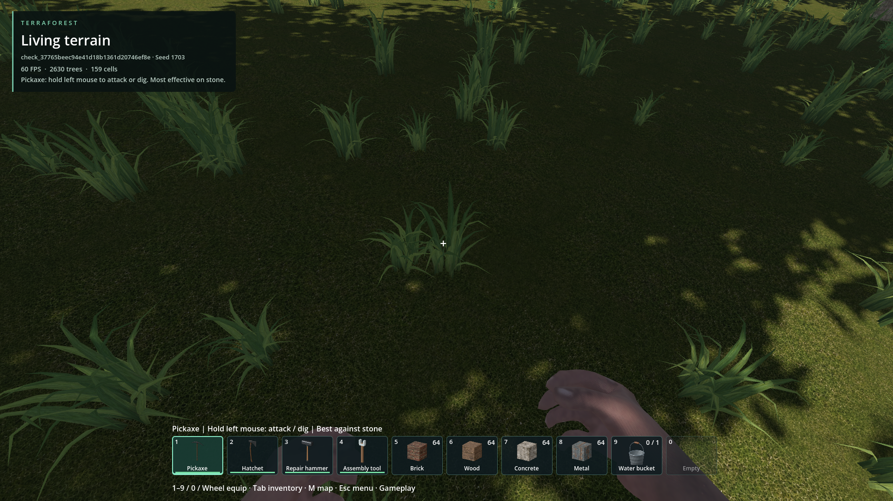

# Quiet world interaction hints

- Status: implemented; scoped automated checks, visual playtest not yet reviewed.
- Updated: 2026-10-26. User requested fewer common-object labels, retained stone
  labels, and unlabeled larger bushes requiring harvesting instead of E pickup.

## Current policy

- No automatic target label: grass, ferns, twigs, low bushes, woody bushes.
- Keep labels: small stones, flowers, boulder mining, doors, containers, corpse
  storage, dropped inventory items and vehicle interaction.
- Both bush species require harvesting in gameplay. Low-bush health/rewards are
  unchanged; woody bushes still take two hits. Developer removal is unchanged.
- Grass/fern/twig collection still works. Inventory names, resource notifications
  and feedback after an explicit action are unaffected.
- Hiding a label does not skip the target or advertise an unrelated nearby car.
  Existing 10 Hz bounded picking is reused; no new world scan or native bake.

## Visual evidence

After: source build on `e77d680b` plus this change; temporary seed-1703 world,
1920x1080. Grass is still reachable and E grants the exact resource. No player save
was selected. There is no matched before image; [provenance](images/manifest.json).

## Checks / resume

- `world_hint_policy`: every species in gameplay/editor, stones/flowers retained,
  bushes hidden, door/container/corpse/pickup/boulder prompts, no false vehicle hint.
- `woodland_accents`: native picking/inventory/removal; E rejection preserves bush
  and inventory, matching completed-harvest identity grants one reward, stale or
  wrong identity rejects; developer removal remains reward-free.
- `ground_interaction_hint`, `pickup_interaction_hint`, `door_world`: actual temporary
  world gathering, capacity rejection, action priority, item recovery and door use.
- Initial ground fixture timed out on an obsolete 49-cell residency requirement;
  it now waits for usable cover and proves an actual reachable target. New bush
  fixture initially registered its reward after inventory mutation, which native
  inventory correctly rejects; registration now happens first. Failed logs retained.
- Final package passes policy, 66 native woodland assertions and actual-world
  gathering. Export initially failed against editor-held reload-library locks;
  it succeeds after the user closes the editor. A packaged screenshot initially
  used read-only `res://`; the external test now uses an absolute output directory.
- [Qualification](qualification.json). Source code:
  [catalog](../../addons/world_ecosystem/ground_catalog.gd),
  [collection](../../addons/world_ecosystem/ground_interaction.gd),
  [presentation](../../demo/world_interaction.gd).

Return if a useful prompt is missing or an ordinary bush still bypasses harvesting.
Capture species, held item and gameplay/editor mode; preserve interaction priority
and reward accounting. This changes existing species only, not all future modded
plants. Latest visual playtest remains unreviewed; no performance speedup is claimed.
