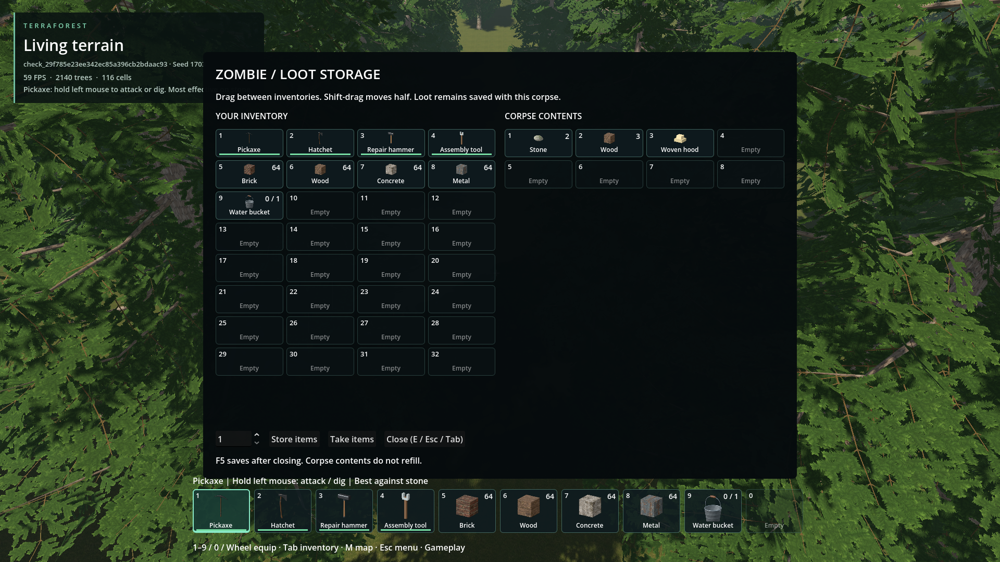
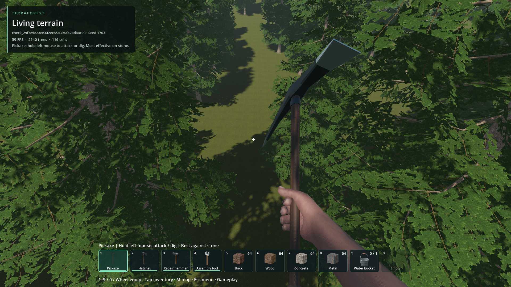
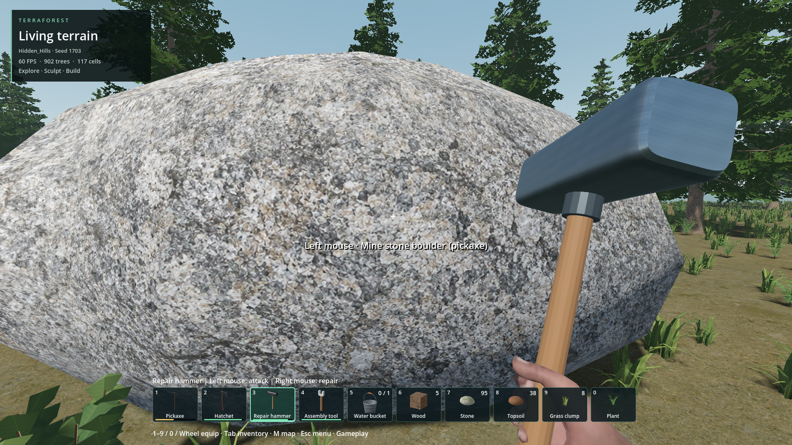
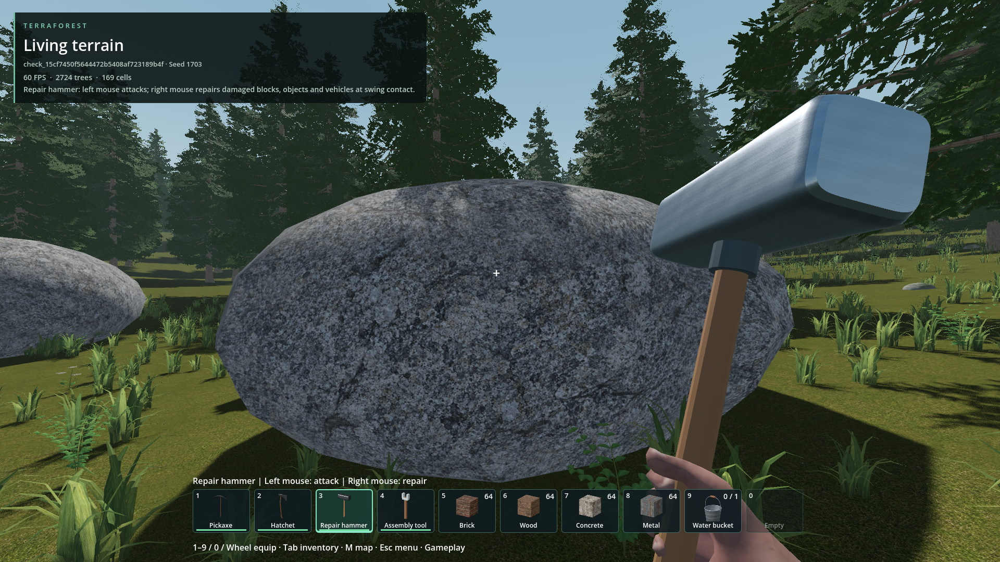

# Quiet world interaction hints

- Status: improved / partial; user rejected the retained boulder instruction.
  That exception is removed; latest visual correction awaits review.
- Updated: 2026-10-26. User requested fewer common-object labels, retained stone
  labels, and unlabeled larger bushes requiring harvesting instead of E pickup.

## Current policy

- No automatic target label: grass, ferns, twigs, low bushes, woody bushes, boulders.
- Keep labels: small stones, flowers, doors, containers, corpse
  storage, dropped inventory items and vehicle interaction.
- Grass and both bush species require harvesting in gameplay. Existing health
  and rewards are unchanged; woody bushes still take two hits. Developer removal
  is unchanged. Ferns, twigs, small stones and flowers remain directly collectible.
- E picking skips harvest-only foliage inside the native query, so foreground
  grass/bushes cannot steal a stone/flower/pickup interaction. Actual solid
  obstructions still block picking; raw tool/harvest selection is unchanged.
- Inventory names, resource notifications and explicit action feedback are
  unaffected. Existing 10 Hz bounded picking is reused; no new world scan or bake.

## E container toggle / grass pickup follow-up

Press E again to close either a chest or corpse-loot UI and restore gameplay
control. The close event is consumed: it cannot immediately reopen the container,
enter a vehicle or collect an item. Key-repeat and release do not close a freshly
opened container. Esc/Tab and the close button remain available; the button now
shows E too. The same storage UI implementation serves chests and corpses.

Grass is now harvest-only. Native `pick_filtered` ignores harvest-only species
before proxy transforms/intersections; interaction preview and actual E collection
use the same eligibility mask. Attack/placement/developer picking retains all
species. No terrain generation or save-format change is involved.

Packaged temporary-world input test, seed 1703, 1920x1080. This fixture uses real
storage UI/native contents and a test corpse identity picker, not a new verification
of zombie death or skinned-corpse targeting. Quantity input is focused before E
closes the UI; mouse capture and unchanged player inventory are asserted.
Native overlap tests prove stone/flower collection through grass and solid-wall
occlusion. A real animated hatchet strike then harvests one natural clump, grants
one grass and consumes one wear. [Workflow qualification](workflow-followup.json).

## Automatic-label audit / rejected exception

The shared world-target presenter had eight target categories: corpse storage,
containers, doors, dropped pickups, small stones, flowers, boulders and vehicles.
The boulder was the only remaining automatic mining/harvesting instruction; it
was incorrectly retained in `6264d5ce`, then explicitly rejected by the user.
All large ground objects now return no hint in gameplay and editor modes, rather
than becoming an "E collect" fallback. Picking, mining and harvest requirements
are unchanged. Seven interaction categories remain; flower colours, door states
and item names are variants, not additional categories.

The two persistent toolbelt/control-help rows and damage feedback after an actual
hit are separate UI, not automatic target labels; this correction does not hide
inventory names or those displays.

User report, Hidden_Hills seed 1703, repair hammer held; exact position was not
provided. Original pixels retained; no claim of a matched saved-world replay.

Correction: actual temporary-world natural boulder, seed 1703, repair hammer held.
Native picking verifies the aimed boulder; the target label is hidden and E cannot
pick it up. This is a different location from the report. The existing tool-help
rows remain visible intentionally. [Follow-up qualification](boulder-followup.json).

## Visual evidence

After: source build on `e77d680b` plus this change; temporary seed-1703 world,
1920x1080. Grass is still reachable and E grants the exact resource. No player save
was selected. There is no matched before image; [provenance](images/manifest.json).

## Checks / resume

- `world_hint_policy`: every species in gameplay/editor, stones/flowers retained,
  bushes and all large ground objects hidden, door/container/corpse/pickup prompts,
  no false vehicle hint.
- `woodland_accents`: native picking/inventory/removal; E rejection preserves bush
  and inventory, matching completed-harvest identity grants one reward, stale or
  wrong identity rejects; developer removal remains reward-free.
- `ground_interaction_hint`, `pickup_interaction_hint`, `door_world`: actual temporary
  world gathering, capacity rejection, action priority, item recovery and door use.
- Initial ground fixture timed out on an obsolete 49-cell residency requirement;
  it now waits for usable cover and proves an actual reachable target. New bush
  fixture initially registered its reward after inventory mutation, which native
  inventory correctly rejects; registration now happens first. Failed logs retained.
- Final package passes policy, 66 native woodland assertions and actual-world
  gathering. Export initially failed against editor-held reload-library locks;
  it succeeds after the user closes the editor. A packaged screenshot initially
  used read-only `res://`; the external test now uses an absolute output directory.
- [Earlier qualification](qualification.json) and [current boulder correction](boulder-followup.json).
  Source code:
  [catalog](../../addons/world_ecosystem/ground_catalog.gd),
  [collection](../../addons/world_ecosystem/ground_interaction.gd),
  [presentation](../../demo/world_interaction.gd).

Return if a useful prompt is missing or an ordinary bush still bypasses harvesting.
Capture species, held item and gameplay/editor mode; preserve interaction priority
and reward accounting. This changes existing species only, not all future modded
plants. Latest visual playtest remains unreviewed; no performance speedup is claimed.
