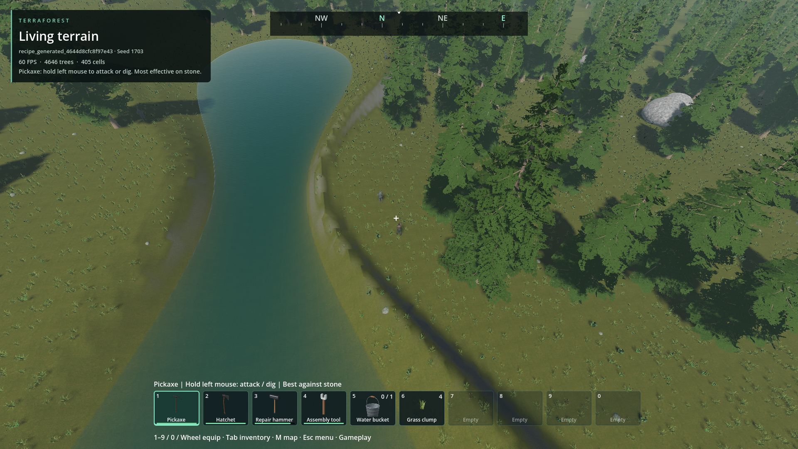
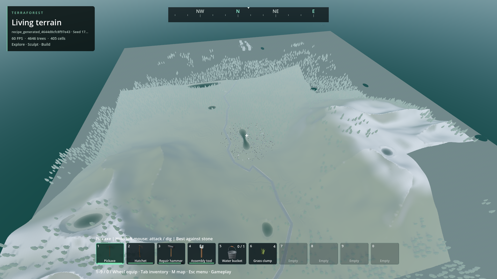
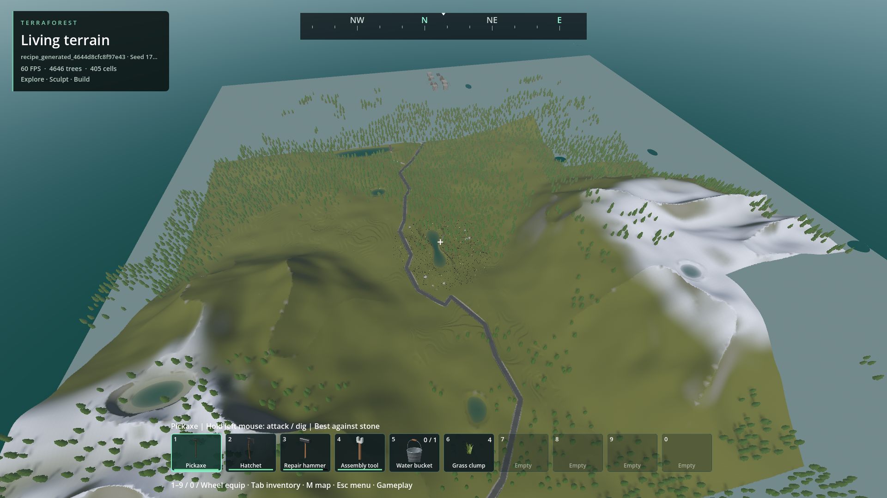
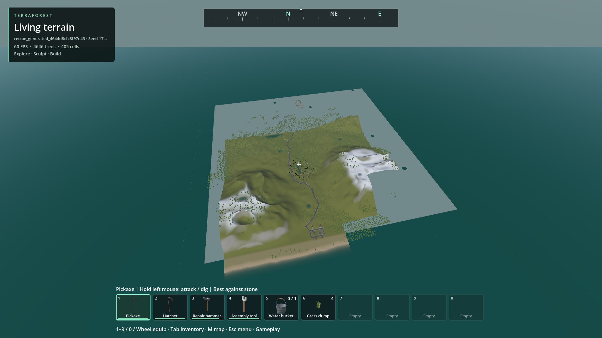
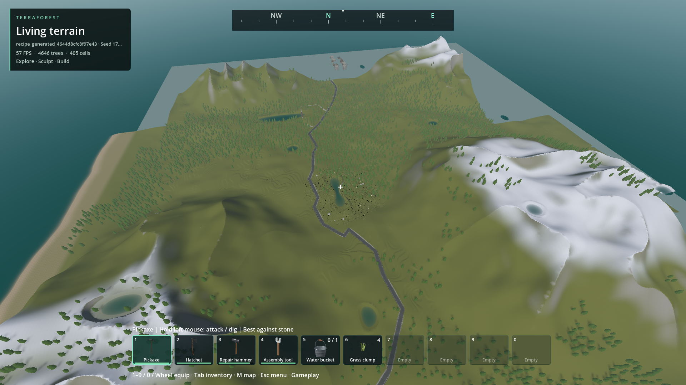
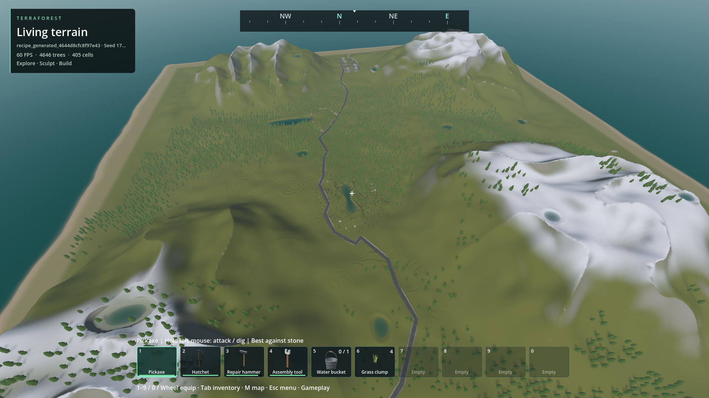
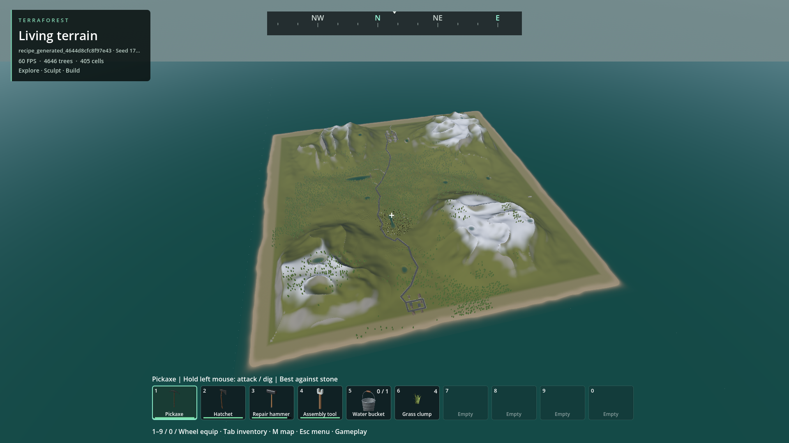

# FPS / world overview

- Status: Improved-partial; whole rendering/modding overhaul remains open.
- Updated: 2026-10-30. Implementation: commit introducing this folder.
- User review: Not reviewed. Engineering evidence is not visual acceptance.
- Symptom: Camera zoom and distant object coverage are not yet a seamless strategy/FPS hybrid.

## Images

All captures use the disposable populated `recipe_generated_4644d8cfc8f97e43`
save, seed 1703, player-following view; the source archive remains unchanged.
Source/build/run hashes are in `images/manifest.json` and linked run manifests.

32 m installed-build overview; existing vegetation and water, no alternative world/map.

Initial 768 m source trial: existing distance fog washes out the overview. Rejected
presentation, retained for comparison; tests passing did not make this acceptable.

Same 768 m view with camera-local fog scaling. Colors improve; coarse terrain,
large flat patches and incomplete forest coverage remain visible. **Not seamless/approved.**

1800 m installed build: large flat grey areas and hard terrain boundaries are
unacceptable for a finished overview. Coverage assertions are not geometry-quality
checks. Diagnose these separately from tree residency; do not hide them with fog.

## Changes and verification

- Native terrain requests accept render focus/projection separately from player
  collision/travel. Coarse coverage survives asynchronous refinement.
- Optional ESC Player overview uses the existing collision boom; wheel zoom and
  mouse orbit do not change physical position, first-person aim or save state.
- Resident tree LOD/culling follows render camera; tree ownership/trunk collision
  stay at the player. Native world-wide building horizon stays enabled.
- Installed fixture: 32/256/768/1800 m; 151 horizon chunks, 2.76 MiB mesh payload;
  no remote editable-building hydration or source-save changes. Frame p95
  18.63–21.48 ms; GPU p95 6.38–8.82 ms. Not a perfect-frame-time claim.
  Sampled process peaks: 3.17 GiB private RAM, 1.39 GiB dedicated GPU allocations.
- Native planner fixture: mean 0.114/0.135/0.122 ms for disabled/remote/high view,
  264/296/264 requested keys; physical activation unchanged. Small synthetic case.
- Generation signature fixture: 4,096 → 32 region captures, 22.058 → 0.326 ms;
  exact digest parity, paging/reload/mutation checked. Not whole generation timing.
- Module fixtures exercise independent controller, external PCK, binary v3,
  missing-provider preservation, malformed data, pooling and parked-kind selection.
- Initial headless parked-mesh readback test failed; the rendered check passes.
  Initial dev-spawner invocation omitted required fleet/gameplay flags and failed;
  the corrected invocation passes. Motion check initially used the wrong completion
  marker; rerun with `MOTION_PARITY` passes. Failed logs remain under reports/checks.
- Installed parked-renderer check initially wrote to read-only `res://reports`;
  it now uses the runner's explicit evidence folder. An external-pack run completed
  before enough GPU samples; tests now keep a three-second telemetry window rather
  than weakening the budget gate. Both corrected installed checks pass.

Evidence: source runs `reports/runtime_views/20261030T063802496788Z` (initial fog)
and `20261030T064221141424Z` (camera-local atmosphere); installed overview
`reports/runtime_views/20261030T072103356539Z`; planner
`reports/checks/20261030T070537951196Z`; signature
`reports/checks/20261030T070538663789Z`. Installed validation is recorded in
`verification.json`; use those exact run manifests for process RAM/GPU observations.

## Missing terrain coverage follow-up — 2026-10-30

The flat grey regions were absent meshes, not simply LOD seams or bad terrain
materials. Native field samples contained hills there. All 64 roots were requested,
but only 37 were actually published after 1,800 gameplay frames. The worker was
running, not deadlocked: distance-first refinement and expensive, over-constrained
coarse columns delayed the far surface. Fog was not changed in this correction.

Previous installed geometry, same read-only fixture, 768 m camera, 37/64 roots.

Installed correction, same fixture/camera: 64/64 actual terrain regions at play,
retained throughout refinement. Photographs precede the test-only excavations.

1,800 m view. No heightmap substitute; existing roads, coast and mountains remain.
Local-only forests and the previously rejected northern district remain unfinished.
This is **not user approval or a claim of seamless transitions**.

- Coarse native owners grow from 32 to 64 m; a root contains 16 instead of 64.
  Simplification pins actual outer borders, edited support and cave vertices, not
  nonexistent internal 16 m / vertical slab boundaries. Fine collision is unchanged.
- Shared owner sizing also governs narrow edit invalidation. One corner edit
  replaces four owners, retains twelve; an empty selection reconstructs nothing.
  Cache identity is `owned-column-v2`; old packets and canonical saves are not reused
  under the wrong representation. No generator/profile/save migration.
- Missing roots precede optional refinement after physical activation. The default
  play gate requires complete actual terrain coverage, not merely requested keys.
  Existing loading counters now report that whole-world gate without new UI.
- Three real saved-field roots: packed coarse mesh bytes decrease 56–70%, triangles
  57–71%. Native construction itself improves little (151–213 → 150–178 ms/root
  in single samples); these are representation/transfer savings, not a 70% FPS gain.
- Packaged fresh-derived-cache fixture: all roots ready at play in 28.22 s;
  resident terrain payload 185.80 MiB against the existing 192 MiB budget. Previously
  it still had only 37 roots after loading plus another thirty seconds. The new gate
  does wait for remaining base coverage; further loading-pipeline optimization remains.
- 32/256/768/1,800 m zoom checks pass with full coverage. Stationary overview frame
  p95 17.73–18.85 ms; source/pack fixed-view maxima 29.68/41.57 ms. Not perfect pacing.
  Packaged process peaks up to 3.21 GiB private RAM / 1.39 GiB GPU; distribution 422.9 MB.
- Eight rendered coarse public-edit-to-draw samples: 74.9–86.3 ms packaged,
  75.2–93.1 ms source, all below the unchanged 150 ms gate. This uses public edit
  transactions, not physical held-button timing or an endurance run. Larger owners
  trade more work per affected owner for substantially smaller distant representation.
- 28 native/worker regression fixtures pass; independent release-DLL volume check
  passes 7,251 commands. Tests cover actual mixed-LOD corner edges, cave joins,
  preserved save bytes, cold/warm/restarted caches, narrow refill and empty halos.
  Rendered loading UI, installed coverage/edit test and installed zoom/vehicle test pass.

[Run receipts and measured costs](coverage-verification.json). Earlier failures are
retained: initial narrow invalidation still used 32 m and was corrected; new seam
tests initially counted perpendicular corner edges as shared joins (now separate
interior-join, full-owner boundary and four-owner crack checks); an edge fixture
edited beyond the world boundary. Two invalid headless loading-UI attempts waited
for a render signal; the corrected nonactivating rendered run passes. One planner
invocation used the wrong completion marker; its actual assertions passed.

## Remaining / resume here

[Open architecture milestones](../../docs/WORLD_RENDERING_CONTRACT.md): canonical
world-wide tree/medium-object pages, seam-safe volumetric transitions, remote
prop/vehicle tiers, general service providers, full generation/loading profiling
and physical 4 GiB hardware/endurance. Custom vehicles currently use the small-car
envelope; pack inventory registration and native dependency installation are open.
The high view deliberately exposes current gaps instead of claiming they are fixed.

## Reproduce

ESC → Player → World overview camera (preview). Click back into the game; mouse
orbits, wheel zooms, WASD moves the actual character. No remote building/mining.
Turn the checkbox off to return to the normal view. Camera defaults stay unchanged.

Safe automated check: `python tools/check_runtime_views.py world_overview --pack`.
Requires the disposable fixture named above. Offscreen/nonactivating; no OS mouse
capture, no player-save writes. See [vehicle pack setup](../../docs/VEHICLE_PACKS.md).
