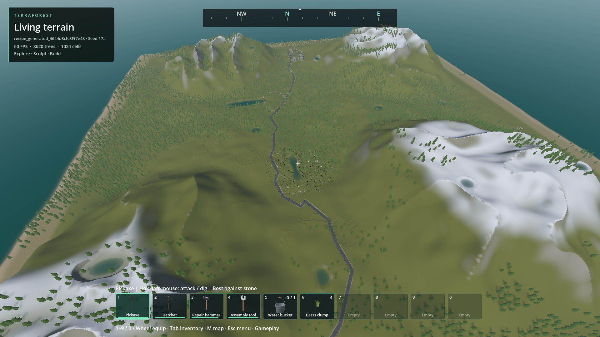
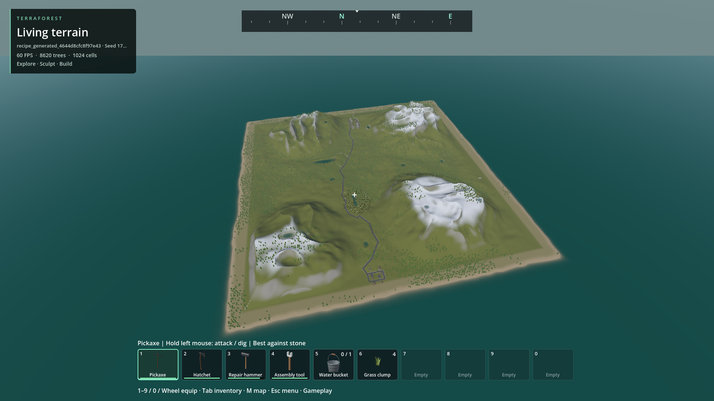
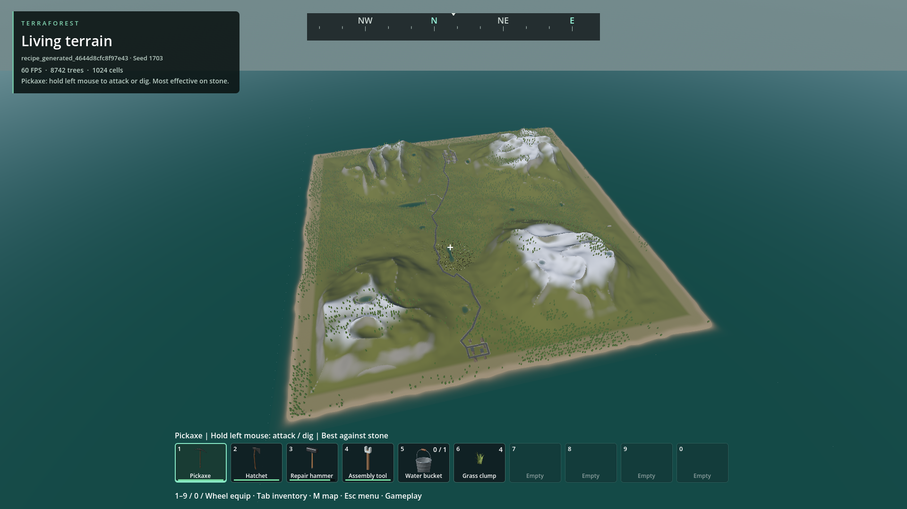
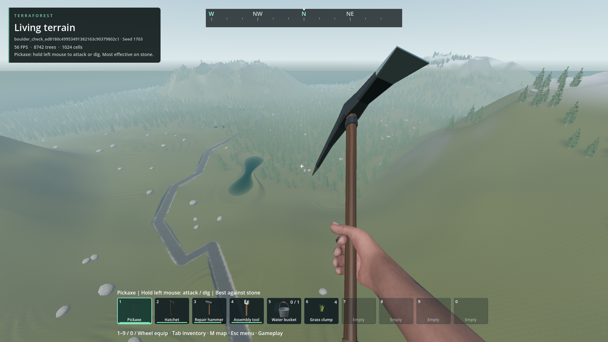
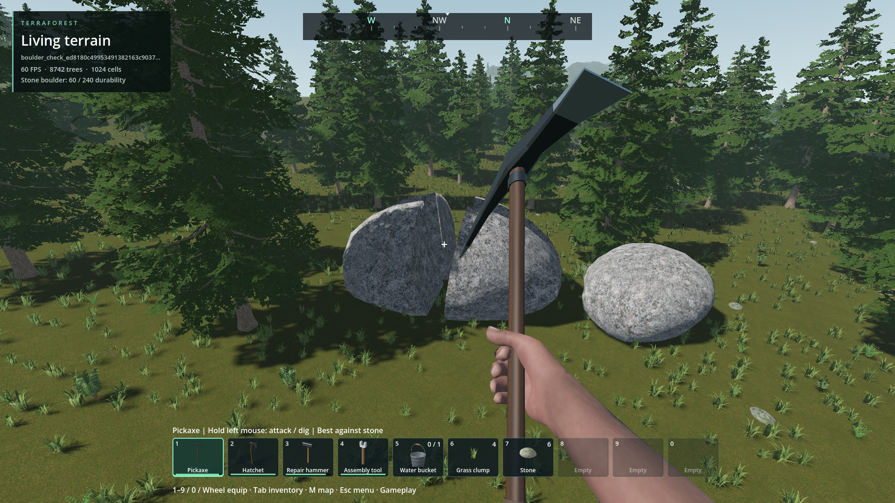
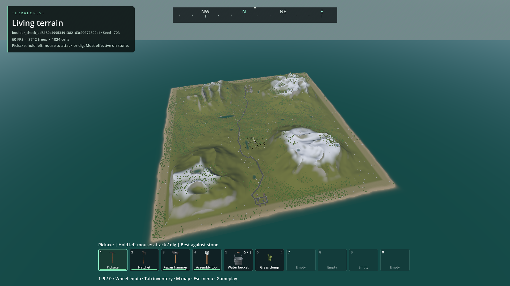
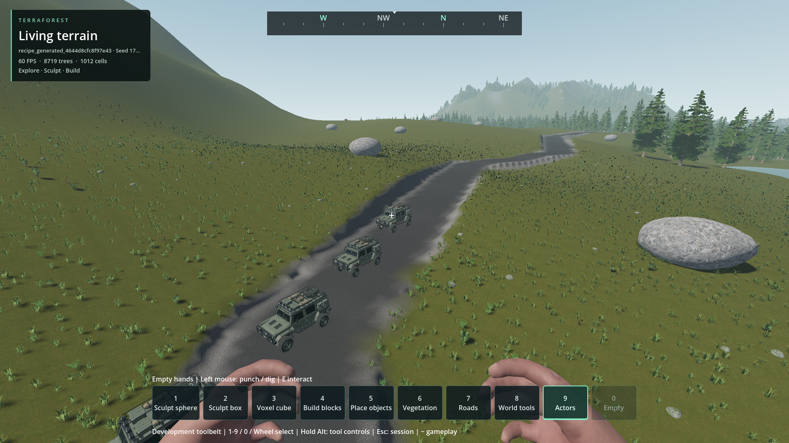
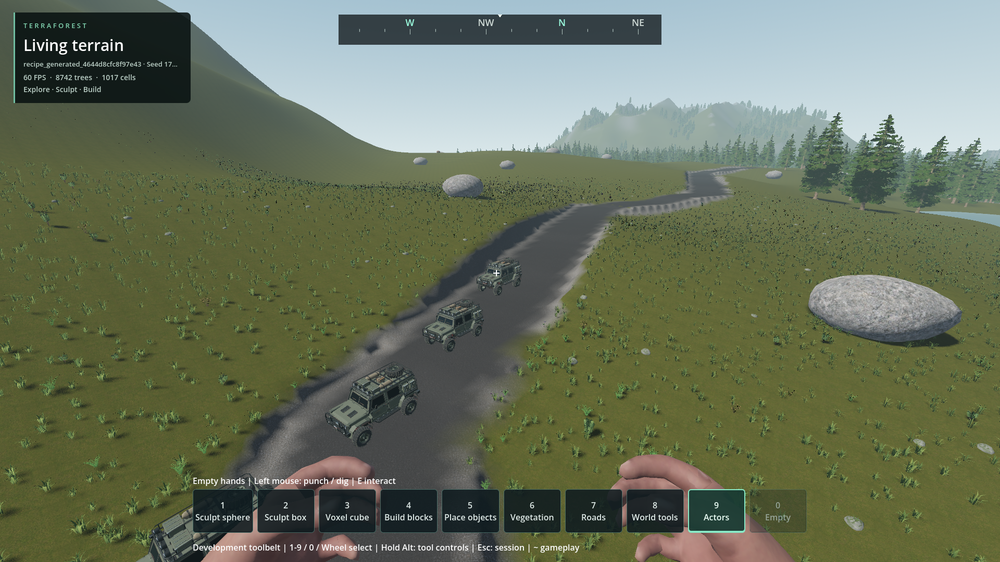
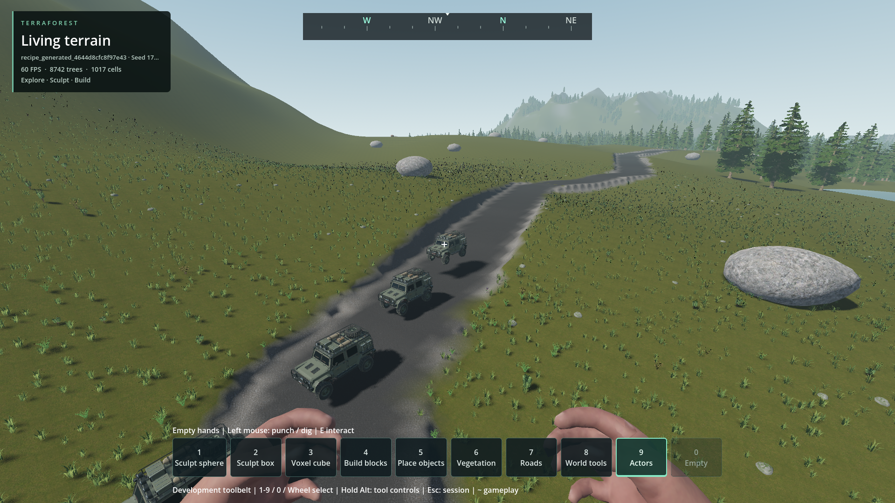
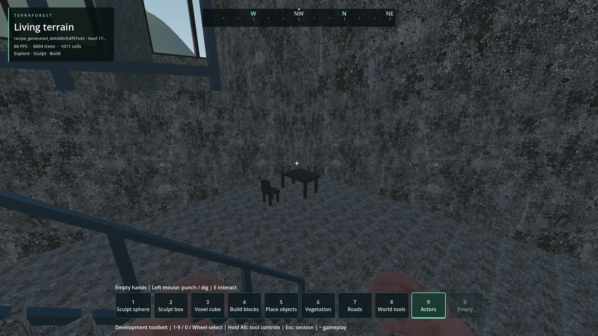

# FPS / world overview

- Status: Improved-partial; whole rendering/modding overhaul remains open.
- Updated: 2026-10-30. Implementation: commit introducing this folder.
- User review: Not reviewed. Engineering evidence is not visual acceptance.
- Symptom: Camera zoom and distant object coverage are not yet a seamless strategy/FPS hybrid.

## Images

All captures use the disposable populated `recipe_generated_4644d8cfc8f97e43`
save, seed 1703, player-following view; the source archive remains unchanged.
Source/build/run hashes are in `images/manifest.json` and linked run manifests.

32 m installed-build overview; existing vegetation and water, no alternative world/map.

Initial 768 m source trial: existing distance fog washes out the overview. Rejected
presentation, retained for comparison; tests passing did not make this acceptable.

Same 768 m view with camera-local fog scaling. Colors improve; coarse terrain,
large flat patches and incomplete forest coverage remain visible. **Not seamless/approved.**

1800 m installed build: large flat grey areas and hard terrain boundaries are
unacceptable for a finished overview. Coverage assertions are not geometry-quality
checks. Diagnose these separately from tree residency; do not hide them with fog.

## Changes and verification

- Native terrain requests accept render focus/projection separately from player
  collision/travel. Coarse coverage survives asynchronous refinement.
- Optional ESC Player overview uses the existing collision boom; wheel zoom and
  mouse orbit do not change physical position, first-person aim or save state.
- Resident tree LOD/culling follows render camera; tree ownership/trunk collision
  stay at the player. Native world-wide building horizon stays enabled.
- Installed fixture: 32/256/768/1800 m; 151 horizon chunks, 2.76 MiB mesh payload;
  no remote editable-building hydration or source-save changes. Frame p95
  18.63–21.48 ms; GPU p95 6.38–8.82 ms. Not a perfect-frame-time claim.
  Sampled process peaks: 3.17 GiB private RAM, 1.39 GiB dedicated GPU allocations.
- Native planner fixture: mean 0.114/0.135/0.122 ms for disabled/remote/high view,
  264/296/264 requested keys; physical activation unchanged. Small synthetic case.
- Generation signature fixture: 4,096 → 32 region captures, 22.058 → 0.326 ms;
  exact digest parity, paging/reload/mutation checked. Not whole generation timing.
- Module fixtures exercise independent controller, external PCK, binary v3,
  missing-provider preservation, malformed data, pooling and parked-kind selection.
- Initial headless parked-mesh readback test failed; the rendered check passes.
  Initial dev-spawner invocation omitted required fleet/gameplay flags and failed;
  the corrected invocation passes. Motion check initially used the wrong completion
  marker; rerun with `MOTION_PARITY` passes. Failed logs remain under reports/checks.
- Installed parked-renderer check initially wrote to read-only `res://reports`;
  it now uses the runner's explicit evidence folder. An external-pack run completed
  before enough GPU samples; tests now keep a three-second telemetry window rather
  than weakening the budget gate. Both corrected installed checks pass.

Evidence: source runs `reports/runtime_views/20261030T063802496788Z` (initial fog)
and `20261030T064221141424Z` (camera-local atmosphere); installed overview
`reports/runtime_views/20261030T072103356539Z`; planner
`reports/checks/20261030T070537951196Z`; signature
`reports/checks/20261030T070538663789Z`. Installed validation is recorded in
`verification.json`; use those exact run manifests for process RAM/GPU observations.

## Missing terrain coverage follow-up — 2026-10-30

The flat grey regions were absent meshes, not simply LOD seams or bad terrain
materials. Native field samples contained hills there. All 64 roots were requested,
but only 37 were actually published after 1,800 gameplay frames. The worker was
running, not deadlocked: distance-first refinement and expensive, over-constrained
coarse columns delayed the far surface. Fog was not changed in this correction.

Previous installed geometry, same read-only fixture, 768 m camera, 37/64 roots.

Installed correction, same fixture/camera: 64/64 actual terrain regions at play,
retained throughout refinement. Photographs precede the test-only excavations.

1,800 m view. No heightmap substitute; existing roads, coast and mountains remain.
Local-only forests and the previously rejected northern district remain unfinished.
This is **not user approval or a claim of seamless transitions**.

- Coarse native owners grow from 32 to 64 m; a root contains 16 instead of 64.
  Simplification pins actual outer borders, edited support and cave vertices, not
  nonexistent internal 16 m / vertical slab boundaries. Fine collision is unchanged.
- Shared owner sizing also governs narrow edit invalidation. One corner edit
  replaces four owners, retains twelve; an empty selection reconstructs nothing.
  Cache identity is `owned-column-v2`; old packets and canonical saves are not reused
  under the wrong representation. No generator/profile/save migration.
- Missing roots precede optional refinement after physical activation. The default
  play gate requires complete actual terrain coverage, not merely requested keys.
  Existing loading counters now report that whole-world gate without new UI.
- Three real saved-field roots: packed coarse mesh bytes decrease 56–70%, triangles
  57–71%. Native construction itself improves little (151–213 → 150–178 ms/root
  in single samples); these are representation/transfer savings, not a 70% FPS gain.
- Packaged fresh-derived-cache fixture: all roots ready at play in 28.22 s;
  resident terrain payload 185.80 MiB against the existing 192 MiB budget. Previously
  it still had only 37 roots after loading plus another thirty seconds. The new gate
  does wait for remaining base coverage; further loading-pipeline optimization remains.
- 32/256/768/1,800 m zoom checks pass with full coverage. Stationary overview frame
  p95 17.73–18.85 ms; source/pack fixed-view maxima 29.68/41.57 ms. Not perfect pacing.
  Packaged process peaks up to 3.21 GiB private RAM / 1.39 GiB GPU; distribution 422.9 MB.
- Eight rendered coarse public-edit-to-draw samples: 74.9–86.3 ms packaged,
  75.2–93.1 ms source, all below the unchanged 150 ms gate. This uses public edit
  transactions, not physical held-button timing or an endurance run. Larger owners
  trade more work per affected owner for substantially smaller distant representation.
- 28 native/worker regression fixtures pass; independent release-DLL volume check
  passes 7,251 commands. Tests cover actual mixed-LOD corner edges, cave joins,
  preserved save bytes, cold/warm/restarted caches, narrow refill and empty halos.
  Rendered loading UI, installed coverage/edit test and installed zoom/vehicle test pass.

[Run receipts and measured costs](coverage-verification.json). Earlier failures are
retained: initial narrow invalidation still used 32 m and was corrected; new seam
tests initially counted perpendicular corner edges as shared joins (now separate
interior-join, full-owner boundary and four-owner crack checks); an edge fixture
edited beyond the world boundary. Two invalid headless loading-UI attempts waited
for a render signal; the corrected nonactivating rendered run passes. One planner
invocation used the wrong completion marker; its actual assertions passed.

## World-wide forest follow-up — 2026-10-30

Installed build, same fixture and camera as `coverage_after_768.png`: distant
forests now exist outside the player's local circle. Inspected, not user-approved.

Maximum overview retains the actual natural trees; no change to land or buildings.

- All 1,024 deterministic natural owners are now prepared before play, not only
  the 405 around the player. The same candidates, supported transforms and stable
  IDs feed the existing native selection/flush and 12-triangle distant tree tier.
  No alternative forest density or generator/save migration.
- Minimum visual range is 3,500 m, extended in 512 m bands from the host-provided
  coverage bounds when an edge/outside-world view needs more. Camera motion within
  a band does not rewrite node culling ranges. Full render ownership does not create distant physics:
  native trunk bodies retain the 96 m / 256-body cap. The populated fixture uses
  8,620 accepted trees; the flat all-owner identity oracle contains 13,574.
- Surface samples have checked binary cache records in the existing cache owner
  and quota. Dependency identity includes local density/blocks plus candidate
  coordinates; local edits invalidate, distant edits reuse, active input skips
  optional cache work. Epoch/revision checks still gate publication.
- Two in-flight surface jobs; at most eight admitted owners per frame. Near
  owners are prepared first. Whole-world acceptance is explicit in loading details.
  Small terrain edits query intersected owner coordinates, not all world roots.
- Source cold/warm read-only reload: 31.31 / 16.09 s; every accepted transform is
  identical. This is more cold work than the prior 28.22 s local-forest fixture,
  not a cold-loading speedup. Harvesting, excavation, binary exclusion roundtrip
  and complete page reconstruction preserve destroyed identities. One root edit
  completes in 38.99 ms; support capture is 0.135 ms.
- Source 100 km/h controlled road-camera sweep covers 585.58 m: zero missing
  forest owners and zero surface requests. Forest-update p95/max: 0.285 / 0.787 ms;
  whole-frame p95/max: 22.81 / 31.72 ms; GPU p95: 8.21 ms. Not physical driving,
  input latency or a pixel-seam qualification. No cursor capture or save writes.
- Exact far exclusions remain open: native unloaded building regions and model
  groups currently reject their conservative bounds. Trees may change membership
  near these groups when exact solids stream in. This pass does not claim that
  behavior is seamless or replace it with a second approximate forest.
- Initial installed checks pass: 28.60 / 15.96 s cold/warm loading; 47.49 ms root edit,
  0.133 ms support capture. The installed 100 km/h sweep has zero missing forest
  owners/requests, forest p95/max 0.259 / 0.892 ms, whole-frame p95/max 17.46 / 32.05
  ms. Sampled peak private RAM 3.36 GiB; dedicated GPU allocations 1.37 GiB. These
  are one-machine scoped observations, not guaranteed budgets on 4 GiB hardware.
- Final adaptive-range build repeats these checks and three outside-world camera
  positions: 31.68 / 15.88 s cold/warm, 52.84 ms root edit; 100 km/h forest p95
  0.284 ms, whole-frame p95/max 18.26 / 31.86 ms. Zero missing forest owners or
  surface requests. The older-generator stationary/travel check also passes.
- Earlier retained failures: new cache test initially had a GDScript inference
  error (fixed); the removal-continuity test was incorrectly invoked headless and
  timed out waiting for drawing (the nonactivating rendered check passes).
  The resampling fixture used obsolete `_scan_timer`; it now uses the actual owner
  limit to select its single test owner, without changing the tested semantics.
- The first installed driving test could not resolve its excluded test superclass;
  the runner now stages that helper beside the external driver and records its
  hash. The corrected installed run passes. City/old-world fixtures now assert
  complete forest ownership plus local physics, rather than the obsolete 441-owner
  limit; the whole city qualification is not rerun or claimed by this change.

Source receipts: `reports/runtime_views/20261030T084527427729Z` (cold/warm,
harvest and excavation), `20261030T084718627066Z` (100 km/h sweep),
`20261030T083522120366Z` (zoom), `20261030T084716020690Z` (removal continuity).
Native/worker fixtures include `reports/checks/20261030T083930261877Z` (all owners),
`20261030T084028802850Z` (surface cache), `20261030T084904926148Z` (resampling),
`20261030T084909987619Z` (mesh-cache regression). Installed evidence follows in
`forest-verification.json`. Engineering verification is not user visual approval.

## Exact far construction exclusions — 2026-10-30

- Whole unloaded 64 m building regions and aggregate model-group bounds previously
  suppressed valid tree candidates between actual solids. Near/far residency could
  therefore change forest membership without a construction edit.
- Native worker-built occupied-column pages and compound-proxy BVHs now preserve
  the same exclusion result as resident records. Cache keys bind owner, archive,
  exact content digest and proxy definition. No far gameplay bodies or hydration.
- Global cache: 32 MiB including entry/page reservations, 256 pages, two reads.
  Packet/decoder scratch and allocator overhead remain separate bounded costs.
  Pending pages keep the previous forest; retries reuse its sampled terrain poses.
- Debug and release: 44 parity/lifecycle checks plus 14 pressure checks pass.
  Pressure includes 100,000 instances in one region (9,204,264 accounted bytes),
  270 sparse regions through a 256-page LRU, eviction/reload and zero live pages
  after teardown. All-block-shape cell occupancy and conservative proxy AABBs
  remain the resident standard, not triangle-exact exclusion geometry.
- Installed populated world: 8,742 stable accepted trees versus 8,620 before this
  change. All 1,024 owners exist before play. Actual block admission/retirement,
  harvest, excavation, owner reconstruction and exact warm reload pass. Source
  archive bytes remain unchanged. Sixty-three occupancy pages cost 321,964 bytes;
  final cold/warm pairs are 29.92 / 16.27 s and 29.74 / 16.54 s. Root edits take
  39.40 / 38.76 ms, support capture 0.133 / 0.128 ms in those two runs.
- Isolated installed 100 km/h road-camera sweep: 585.58 m, zero missing forest
  owners or surface requests; forest update p95/max 0.260 / 0.675 ms, whole-frame
  p95/max 17.68 / 23.08 ms. Local ground-cover residency still lags by up to eight
  near / 33 visible owners; that remains open. These counts are not pixel-gap
  measurements, nor is this physical-vehicle or pixel-continuity proof.
- Retained failures: the new fixture first used a nonexistent admission field,
  then an out-of-range advancement time budget; bounded corrected fixtures pass.
  The archive regression was initially invoked with a nonexistent completion marker;
  its corrected run passes. The first world travel sample visited empty terrain:
  it is **not** streaming evidence. The final test selects an actual unavailable
  region and asserts that both admission and retirement counters increase.
- Early world runs emitted one/two unnamed ObjectDB leak warnings. The harness
  missed the singular wording; it now rejects both, with six launcher tests passing.
  Page counters then caught a retained exclusion payload during teardown. Production
  completions now transfer owned C++ data rather than a Godot object in a Variant.
  The precise engine-internal refcount cause is not established. Native checks cover
  24 pending/completed/consumed cancellation cycles per configuration. A source run
  and two consecutive installed cold/warm pairs release all pages and pass strict
  ObjectDB diagnostics. Broader mixed-world lifetime endurance remains open.

Evidence and build identities: `exclusion-verification.json`. The installed world
final repeated fixtures are `reports/runtime_views/20261030T102255872240Z` and
`20261030T102429817507Z`. User visual acceptance,
dense mixed-model paging, water-edit endurance and seamless frame delivery remain open.

Earlier candidate of the same read-only seed-1703 fixture at 1800 m, 8,742 trees.
Final installed view also inspected in `20261030T102255872240Z/forest_0.png`:
coverage remains present; coarse tree shapes, terrain transitions and the rejected
northern layout remain visible. This view alone cannot prove near-building parity;
the native and actual-region residency assertions provide that scoped evidence.

## Whole-world boulders — 2026-10-30

Natural boulders now retain independent world ownership, rather than disappearing
when local grass retires. Native cached detailed/distant fracture meshes use the
same canonical mining/removal identity and GPU transition; distant geometry has
no per-object distance cutoff. Physics remains player-local. Support requests
share the forest's bounded binary surface pages; no grass density was reduced.

See `boulder-verification.json` for exact runs/builds, retained failures and costs.
The installed populated fixture keeps 368 boulders through travel and zoom;
production targeting, per-hit/final rewards, excavation and compound save/reopen
are checked. The camera-binding check uses the real overview camera, not a moved
first-person camera. Nearby mining can resolve its bounded exclusion work without
waiting behind distant queued owners; genuine pending surface work still blocks.

Installed seed-1703 clone, 150 m up / 300 m back from the selected boulder.
Default first-person atmosphere retained; other vegetation/terrain limits remain.

Same clone after checkpoint restoration and six production pickaxe contact
operations; settled stage-two fragments. This is not an attack-input animation test.

Production 1800 m overview: all 368 accepted boulders use their distant tier while
collision stays near the player. Images inspected; user visual acceptance pending.

The final 100 km/h road-camera sweep retains every exact boulder identity/pose:
585.58 m, 1,266 moving frames, boulder coordinator p95/max 0.151 / 0.329 ms.
Unchanged exclusion masks reuse accepted rows (2,402 reuses in the moving sample),
down from 0.768 ms p95 in the preceding uncached run. Whole-frame p95/max remains
21.98 / 37.27 ms; this is not a perfect-frame-delivery claim. Process private-commit
and dedicated-GPU sampled peaks are 3.62 / 1.47 GB on an RTX 4050 Laptop GPU.
Grass still lags by up to ten near / 34 visible owners; no grass-continuity claim.

Continuous pixel-level transition quality, dense edited worlds and actual driven
vehicle endurance remain unqualified. Other medium props, grass coverage
and the broader overhaul remain open. Existing terrain seams and coarse forest
appearance are not fixed by this boulder change. User visual approval is pending.

## Whole-world parked vehicles — 2026-10-30

Known vehicle providers now retain exact render-only instances outside the old
128 m parked range, with native 256 m cells / 128-instance pages. Shared imported
meshes/materials/LODs are reused; no replacement boxes, full remote physics or
per-frame fleet scan. Near/body ownership changes publish complementary views in
the same frame. Initial saved coverage gates play, including never-near vehicles.

See `vehicle-verification.json` for debug/release, installed and regression runs.
Twenty-three native checks include 65,536 records with a **one-box prototype**;
this is not full-car GPU pressure. The installed populated fixture uses four
actual Rangers, checks exact imported LOD retention, component restoration and
the production loading gate in a second world. No source-save writes.

Installed exact Ranger geometry rendered by the far owner, camera close for
inspection while physical focus is elsewhere. Test poses are frozen above sampled
terrain; wheel contact/placement is not qualified. Fourth car is partly behind HUD.

Same camera after near promotion: exact geometry retained without duplicate far
instances. Near shadows appear; far shadows are intentionally off. That difference
is not a seamless-shadow claim. Images inspected, not user-approved.

At this milestone Ranger retained 32 parts; the following consolidation milestone
addresses far draw/transform cost. Bounded near-handoff latency, continuous
zoom/driving and shadow transitions remain open. Return with populated-world
pressure and continuous visual evidence. Missing packs keep canonical records
but cannot render substitute cars.

Follow-up isolated actual-car baseline: 64 / 1,024 / 4,096 Rangers retain their
32-part meshes and imported LODs. At 4,096 cars the renderer issues 2,048 visible
draw calls; overview GPU/render-CPU p95 is 4.96 / 3.48 ms. All 32 parts share one
material, making exact per-material consolidation the next candidate. The close
1,024-car phase includes a 76.60 ms frame of unestablished cause; functional PASS
does **not** mean performance accepted. No terrain, driving or cast shadows in
this baseline. Raw samples and inspected images remain in
`reports/runtime_views/20261030T124816059552Z`; receipt records all phases.

## Offline vehicle consolidation — 2026-10-30

The built-in Ranger now uses one far part instead of 32, while nearby/physical
meshes remain unchanged. Native offline baking preserves base geometry,
normals/tangents, UVs/colors, material and all 99 distinct imported LOD thresholds.
Export fingerprints refresh the compressed binary when sources change. Runtime
hash-checks it once and falls back to original parts if stale or unavailable;
there is no gameplay mesh rebake. Other vehicle packs can opt into the same
adapter hook, keeping their original geometry by default.

Installed same-process A/B at 4,096 actual Rangers: draw calls **2,048 → 64**,
transform capacity **12 → 0.375 MiB**, overview render-CPU p95 **2.59 → 0.22 ms**.
GPU median is 5.68 → 5.56 ms, not a meaningful universal GPU speedup claim.
GPU tails vary: the compact 64-car phase reaches 7.70 ms p95 versus 4.48 ms for
the original. The shared bake adds a 5.91 MB file and fixed mesh memory; transform
savings are not total-memory savings. No terrain, cast shadows or driving in
this pressure fixture. Mixed-world GPU/frame delivery remains unqualified.

The initial consolidation regressed GPU cost by double-applying source-part
scale to imported LOD thresholds. It was rejected, corrected to the MultiMesh
parent-scale policy and covered by a regression check. Rendered mesh readback
also cost tens of milliseconds, so production baking moved entirely offline.
Packaged validation caught Godot's rewritten import metadata; raw source/import
hashes are now checked before export, with output-binary integrity always checked
in-game. Failures and intermediate comparisons remain in
`vehicle-consolidation-verification.json`, alongside final source/release/pack runs.

Final installed read-only seed-1703 fixture, same elevated frozen test poses as
the earlier comparison. One far mesh group; original silhouette/material retained.
No far cast shadows. The fourth car is partly hidden behind the HUD.

Same camera after near promotion to the original 32 parts. Existing near shadows
appear; no claim of seamless shadow transition or wheel-contact qualification.
The production play gate, canonical component bytes, remote removal and actual
one-part admission pass; the source world hash is unchanged. Synthetic release
checks pass, as do installed prototype, cost, world, external-pack, ownership and
near-renderer checks. Images inspected; user visual acceptance remains pending.

## Read-only model render page foundation

- Native exact-checkpoint reads use the existing archive worker, not distant
  gameplay/physics activation or a new worker per model type.
- Immutable packed records retain canonical IDs and affine transforms. Bounded
  GPU pages reuse the exact source mesh/material/LOD resource; no proxy artwork.
- One 100,000-instance payload uses 5,600,040 accounted native bytes. This excludes
  encoded/parser scratch, shared meshes, engine allocations and caller GPU pages.
- Corruption, wrong versions, sparse IDs, negative origins, mirrored/sheared
  transforms, GPU readback, pressure and cancellation/lifetime are covered by
  `tests/model_render_pages.gd`. Evidence: `model-render-pages-verification.json`.
- The primitive's original verification is retained. Main-world integration now
  follows below; those original primitive tests alone did not establish coverage.

## Persistent static-model coverage

- One native renderer now retains registered static-model visuals across the saved
  world; nearby canonical records and physics can retire independently. Existing
  source meshes/materials/imported LODs remain unchanged. No distant cutoff.
- Default publication: 1,024 records/two uploads per tick, 256-instance pages,
  cooperative 1.5 ms target, two archived payload slots, 128 MiB planning budget.
  Explicit pressure can recover after removals; it does not silently report ready.
- Debug/release pressure represents 100,000 props in 391 pages with 4.8 MB of GPU
  transforms. Removal/undo, moved IDs, native prefab insertion, door rotation,
  archive-read/edit races, cancellation and source destruction are checked.
- Normal worker save/reload/reset and fresh-scene edited-pose tests pass. The
  populated world represents all 660 registered props in 203 pages, including a
  table 997 m from the physical player. Canonical admission keeps the same GPU
  page without an upload; original save bytes remain unchanged.
- **Scoped engineering verification, not universal seamless-rendering approval.**
  Full-prototype dense cost, continuous driving/zoom, shadow changes, fully sliced
  resets and long mixed-world endurance remain open. Unauthored LODs are not invented.
  Counters exclude shared meshes/engine allocations; sampled process budgets are
  recorded separately. See `model-horizon-verification.json` for build and evidence.

Seed 1703, table `(1011,60,270)`: the camera is nearby, but the physical player is
997 m away and furniture canonical records are unloaded. The retained source
meshes remain visible; actual GPU transforms are checked. Installed-build image
inspected, not user-approved artwork or evidence of seamless continuous zoom.

## Remaining / resume here

[Open architecture milestones](../../docs/WORLD_RENDERING_CONTRACT.md): canonical
medium-object cost/transition qualification, mixed streaming/lifetime endurance, seam-safe volumetric transitions, remote
prop tiers and dense-vehicle/transition qualification, general service providers, full generation/loading profiling
and physical 4 GiB hardware/endurance. Custom vehicles currently use the small-car
envelope; pack inventory registration and native dependency installation are open.
The high view deliberately exposes current gaps instead of claiming they are fixed.

## Reproduce

ESC → Player → World overview camera (preview). Click back into the game; mouse
orbits, wheel zooms, WASD moves the actual character. No remote building/mining.
Turn the checkbox off to return to the normal view. Camera defaults stay unchanged.

Safe automated check: `python tools/check_runtime_views.py world_overview --pack`.
Requires the disposable fixture named above. Offscreen/nonactivating; no OS mouse
capture, no player-save writes. See [vehicle pack setup](../../docs/VEHICLE_PACKS.md).
