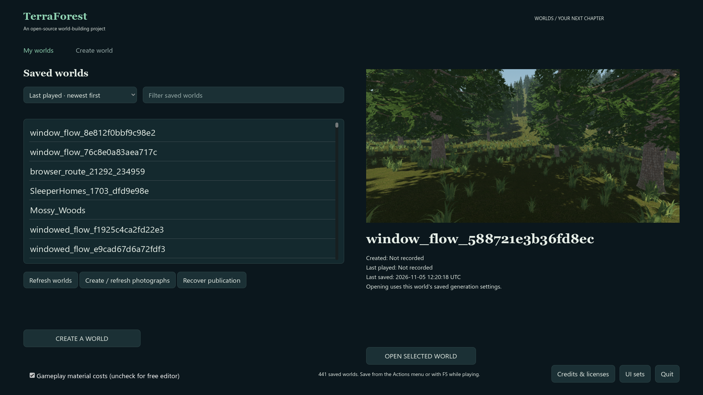
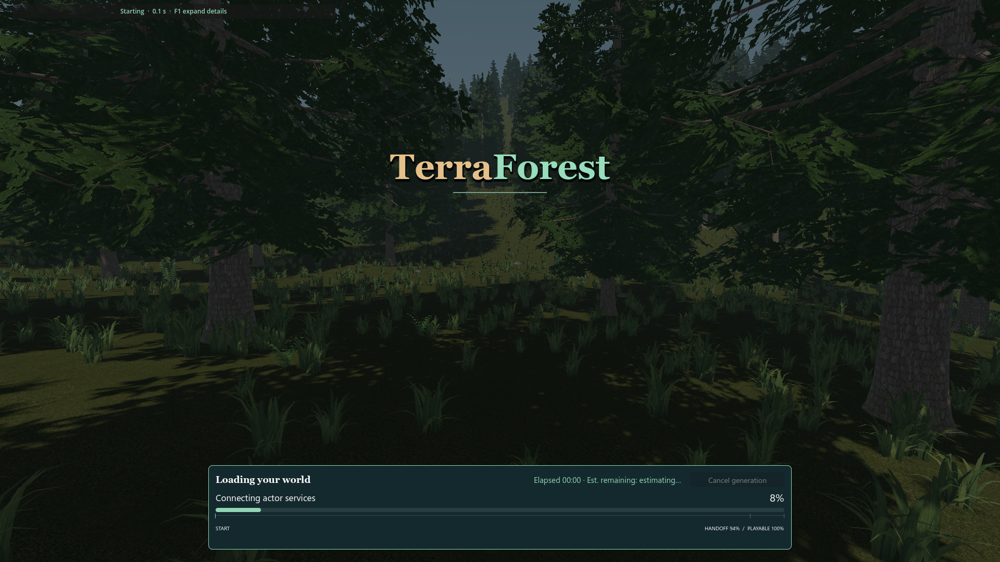
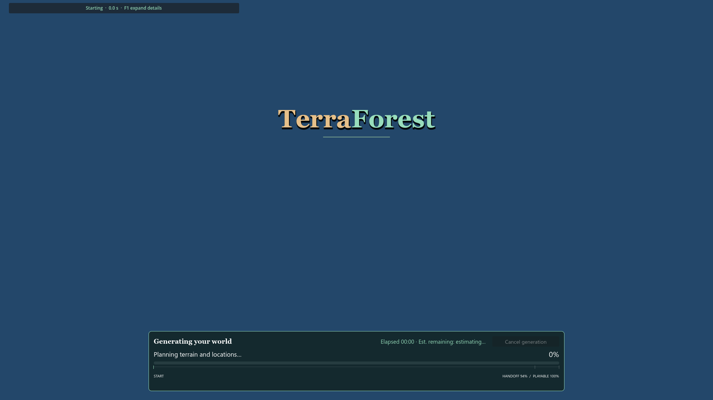
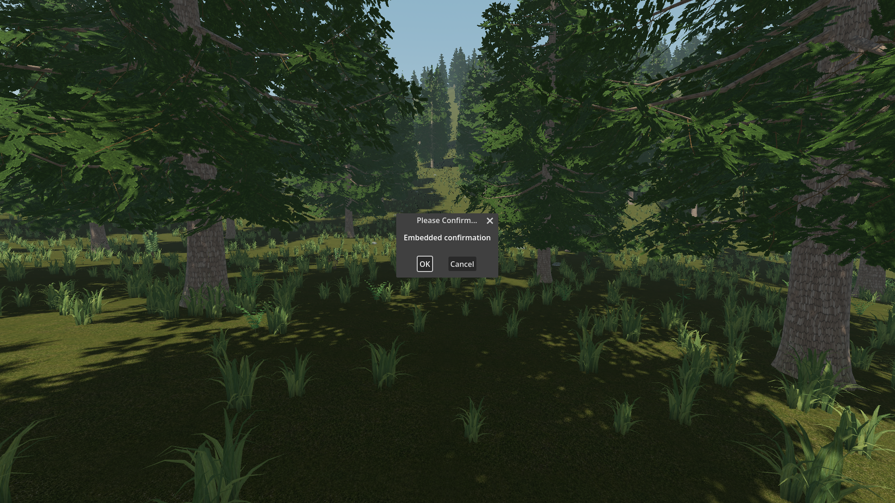
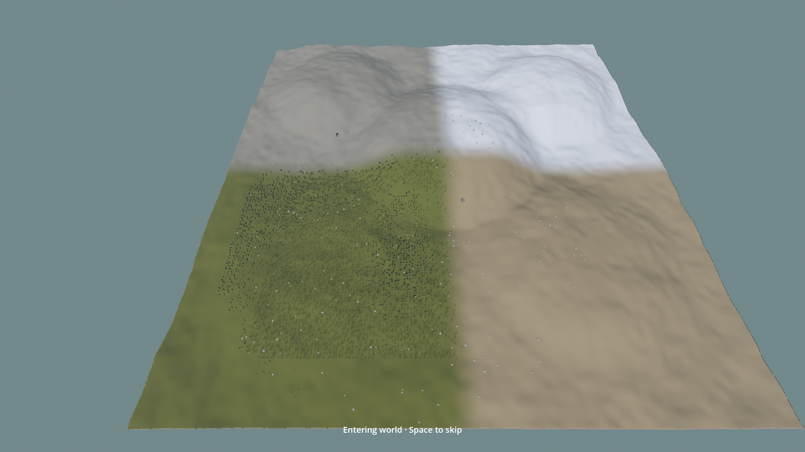

# Missing world photographs in browser and loading

- Status: Fixed for reproduced availability case; source/package checks pass; player review pending.
- Updated: 2026-11-05 (settled-frame timing).
- User review: Reports that loading backgrounds and selection images are absent; follow-up visual review pending.
- Symptom: Recent saved worlds show blank photograph areas, including the early resource-loading screen.

## Changes and verification

Read-only inspection found empty `.preview` directories for the twelve most
recent saves, including the user's SleeperHomes world. Its metadata reported zero
photographs. This follows the deliberate removal of optional destination-photo
traversal from normal generation. Existing older-world PNGs remain on disk.
Separately, `WorldSession.open_world` never assigned any photo to the cover that
spans resource loading, even when the world already had one.

The early cover now receives the selected world's image. Browser and full-size
loading share discovery/fallback for `north`, `road`, `market`, and `arrival`.
Normal writable play captures one clean arrival when no usable image exists.
It waits for the loading cover, entry/waking camera and modal dialogs, hides HUD/held tools for the
single captured frame, restores their state, and encodes the detached image on a
worker. The image remains alive until encoding completes. Only optional sidecars
are published after an actual save; canonical data is unchanged. Existing images,
temporary worlds, read-only snapshots and offscreen refresh worlds are protected.

`python TerraForest/tools/check_ui_sets.py --photographs` checks clean automatic
capture, modal waiting, metadata and canonical hashes, and actual rendered pixels
in the browser and early cover for all five UI sets. `--flow` verifies a real
world's automatic arrival survives save/return, plus open/reopen/manual-photo/
cancel flows. Add `--pack` to test the installed resources.

## Timing of the automatic frame

The first reproduction generated a world with `generation_job.gd`, launched it
with `--generation-handoff`, and received `PhotoProbe.preview/arrival.png`
automatically; a normal reopen without the handoff regenerated it after the
image was deleted, and the browser then displayed it as that world's photograph.

Two weaknesses remained. The frame was read on the first ready frame, and a
capture that found the loading cover, a modal or a still-loading world was
dropped for the whole session.

The earliest moment that makes sense is the first frame after the loading layer
is hidden (`loading_active=false`), which is where the controller calls
`arrival_photograph.request()`. `capture_image` hides every CanvasLayer, so a
readback taken earlier would silently store still-streaming terrain under a
hidden loader rather than the world the player is about to see. The capture
therefore waits for the session cover, modals and the entry camera, reads
exactly one frame, and retries every 0.5 s (bounded to 60 s) if that frame is
blocked or empty. It never invents a frame and never recaptures an existing
photograph, so one picture per world is the stored result.

Measured on a real generated world (generator 29, seed 2, generation handoff):
`ARRIVAL_PHOTO capture_ms=3247 published_ms=3792 attempts=0 readbacks=1`, with
`ARRIVAL_WAIT cover=false popup=false entry=true windows=[]` before it. The whole
3.2 s wait is the entry/wake presentation finishing, not the loader and not a
modal; the PNG encode adds about 0.45 s. That is the earliest frame where the
world, rather than the loading cover or the fly-in, is what the photograph would
contain.

Source and package photo-display checks pass 24 each; real source world flow
passes 25 and package flow 26 (including the added early-cover assertion).
Packaged Last World presentation passes 11. Rendered images were inspected.
[Receipts, rejected trials and provenance](evidence.json).

## Images

Source real-world flow, generator 1 / seed 1703, Survey 1920x1080 Forward+.
Actual clean arrival PNG after save/return. Scoped photograph availability proof;
world art and the inherited list layout are not newly approved.

Packaged real-world reopen, generator 1 / seed 1703, Survey 1920x1080 Forward+.
The saved arrival is already behind the resource-loading cover. The bar is the
actual loading observation, not a test percentage or screenshot backdrop of UI.

Blue-image regression fixture proves visible PNG pixels behind the loader in Survey.
The same rendered check covers every installed UI set.

Earlier source attempt included a confirmation dialog. Retained as rejected evidence;
current capture waits for modals and rejects a frame if a popup appears during it.

Earlier source attempt caught the fly-in and entry hint. Current readiness callback
waits until normal player view, entry/waking completion and closed menus.

[Sources, hashes, settings and provenance](images/manifest.json).

## Remaining / resume here

A world without a photograph cannot display its actual screenshot before its
first playable frame. The first successful visit/save supplies future browser
and loading images. Existing worlds are not bulk-opened or regenerated. The
three-view manual refresh remains optional. Before Last World identifies its
slot, its catalog-search cover is necessarily neutral. Player visual approval
and weak-hardware readback/encoding timing remain unqualified.

If images remain absent after a successful visit/save, inspect the exact slot's
`arrival.png`, metadata, active UI set and cover texture. Run the same source/PCK
pixel and real-world flow checks; preserve failed images rather than declaring
file existence alone a visual fix.

Original implementation/tests are Codex-assisted project code under 0BSD. Captures
are TerraForest diagnostics; inherited game art retains its provenance and terms.
No external assets or fonts were imported.
