# Wearable clothing packs and trader outfit

- Status: Woven revision 1 installed; trader role and trail pack source-verified,
  awaiting the next coordinated package.
- Updated: 2026-11-01. Fix/build: woven woodland and trail revision 1; see focused Git history.
- User review: Shown woven trader outfit and trail set approved on 2026-11-01.
  User requested both in the next combined build, with all outfits available.
  Broader character/animation quality remains separate.
- Symptom: Head, Body and Feet accepted the three woven items without changing
  the character's 3D outfit; inventory silhouettes were generic folded boxes.

## Trader role and trail set

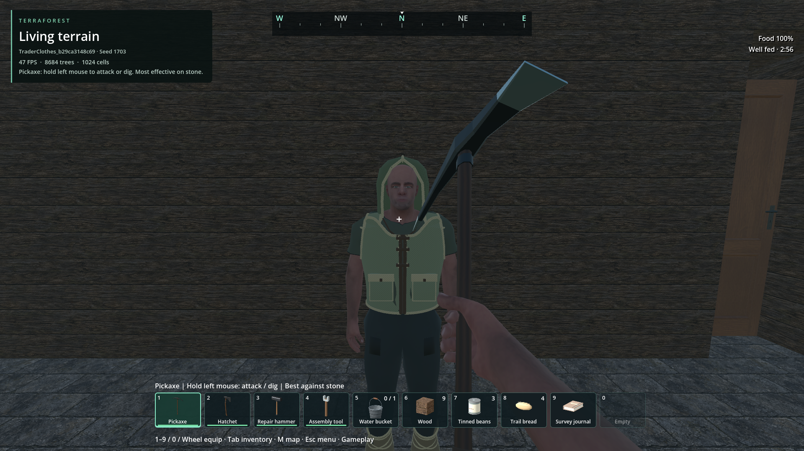

The real resident trader wears the woven hood, vest and footwraps. This is a role
appearance, independent of finite shop stock and player equipment. The existing
idle animation, interaction ray, shop opening and streaming retirement/recreation
all pass in an owned copy of a generated world (17 checks). No user save is edited.

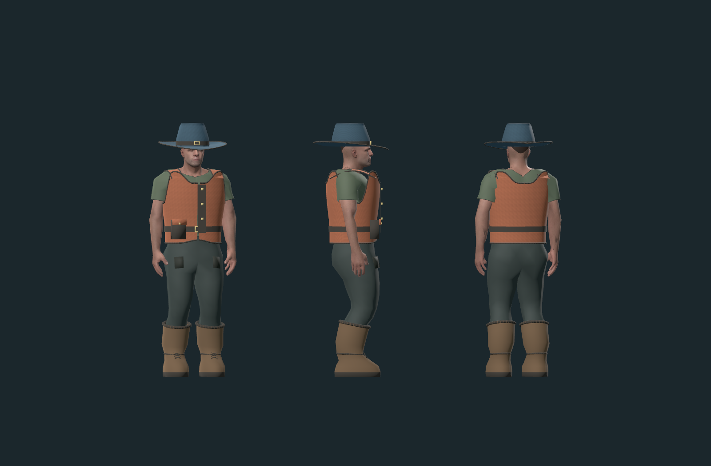

Second original CC0 pack: blue broad-brimmed hat, rust belted jerkin with an
asymmetric pouch, and tall cuffed boots. IDs 304–306 cost 3/6/5 plant fibres.
Both packs remain craftable; matching Head/Body/Feet slots support mixing and
swapping. A swap returns the previous garment to the source backpack slot.
The trail hat retains short hair and is hidden in first person.

The trail source check passes 62 assertions, including all six meshes/weights,
drop sizes, paid recipes, two-way pack swaps, saved equipment and portrait caching.
The original woven regression also passes all 62 assertions.
Normal generated-world crafting/equipping/saving passes 15 checks, followed by
8 checks restoring the outfit into the animated player and portrait in a fresh
process. Source reports and preserved logs: [trail-evidence.json](trail-evidence.json).

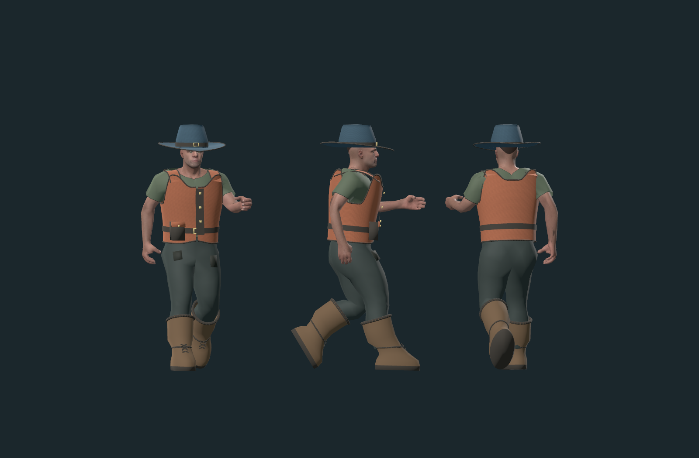

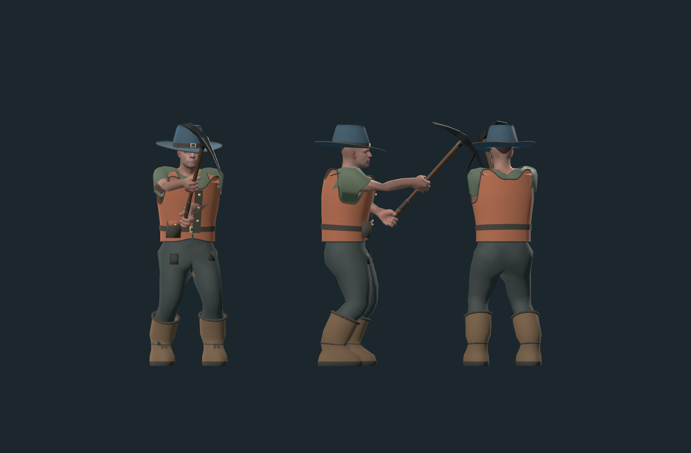

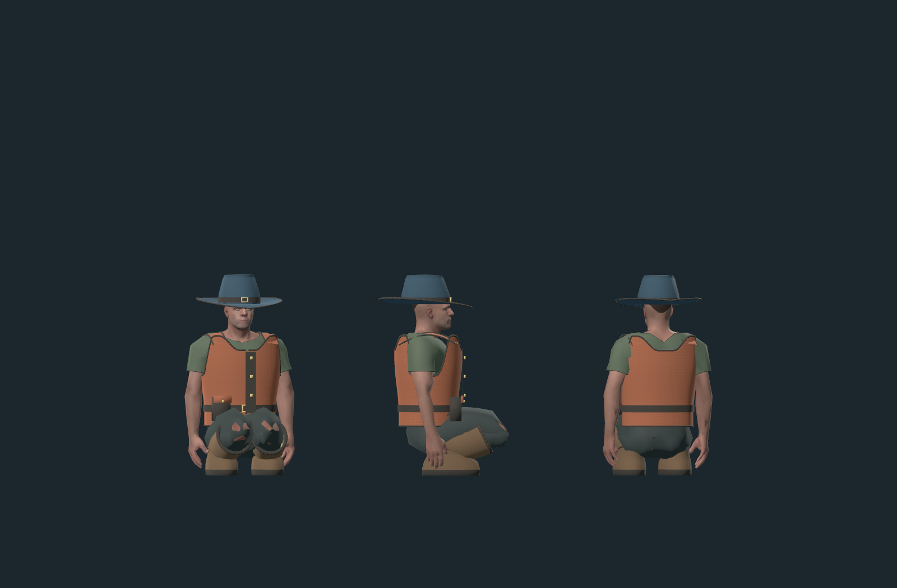

Assistant inspected front/side/back Idle, Walk, Run, crouch, pickaxe and punch
samples. The new garments remain attached in those samples; the inherited
trouser knee clipping and shirt shoulder defects remain. This is not an all-frame
fit guarantee; the subsequent user approval covers the shown appearances.

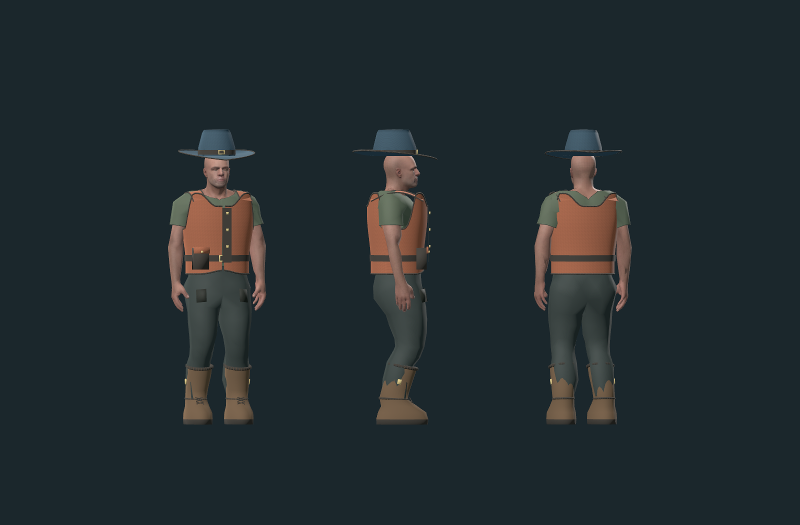

The first trial sat the hat too high and allowed trousers through the boot shafts.
The corrected fit lowers the hat and widens/deepens the shafts. The failed swap
assertions in the same report came from a stale test HUD snapshot after granting
alternate items; refreshing it exercises the existing native swap transaction.
No native inventory change was required. Rejected evidence is retained.

Portable garment-only GLBs, skinned Godot resources, editable generators and
asset terms are in the [trail pack](../../addons/characters/wearables/trail/README.md).
The shared atlas changes only through the existing dependency-aware bake; scoped
derivative receipts and offline notices preserve other assets' terms.

The next coordinated build must include the approved trader role and both player
clothing packs. All six pieces remain craftable/equippable and can be mixed by slot;
unequipping restores the original base outfit. There is no trader-only clothing
restriction. The woven set costs 9 plant fibres and the trail set costs 14.

The combined export and matching package HUD/world/trader checks remain pending.
Run both woven and trail HUD checks to verify all six paid recipes, then normal
world save/restore and trader interaction/respawn. The earlier installed evidence
below applies to woven revision 1. The main build chat owns the next export.

## Images

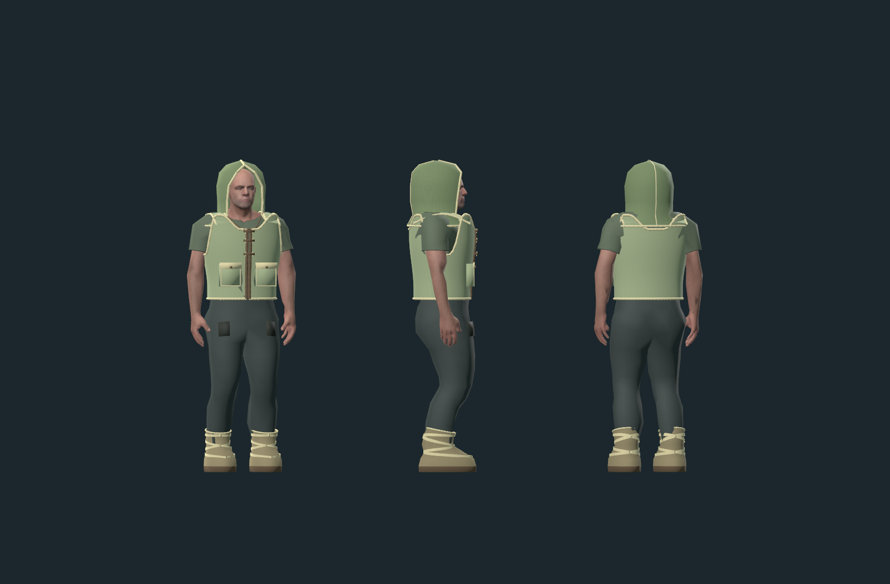

Revision 1, Godot 4.7.2 Forward+, 1600×1050, front/side/back sampled R11 Idle.
Original hood, vest and footwraps share the existing animated skeleton. The old
carry harness is hidden with the replaced field vest. Assistant visually reviewed.

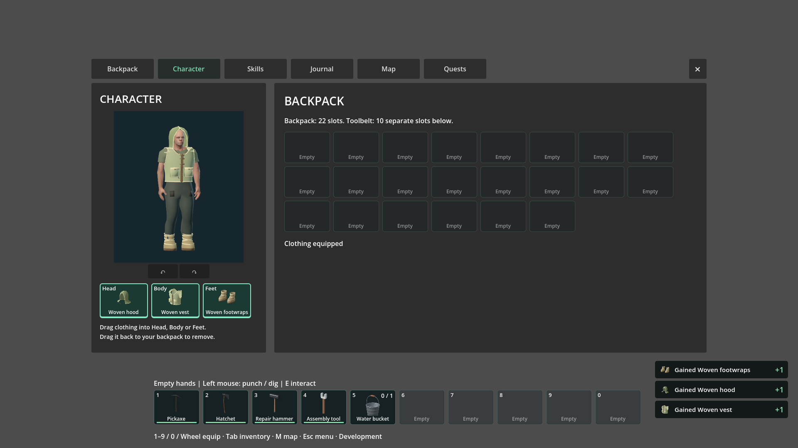

Source HUD, 1920×1080, same actual garment meshes in the portrait and icon bake.
All three were crafted from nine plant fibres and equipped through ordinary slots.
The navigation shell is concurrent work, preserved by this clothing change.

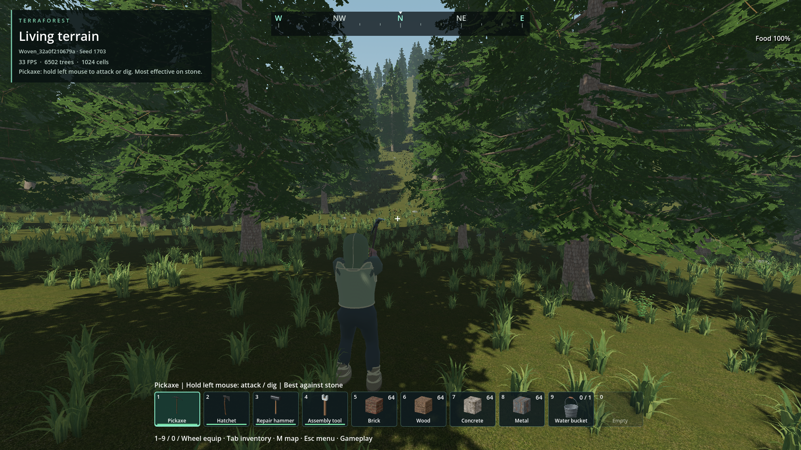

Dedicated `Woven_` fixture, generator 1 / seed 1703, ordinary world entry and a
fresh process after saving. Existing third-person camera, no user save edited.

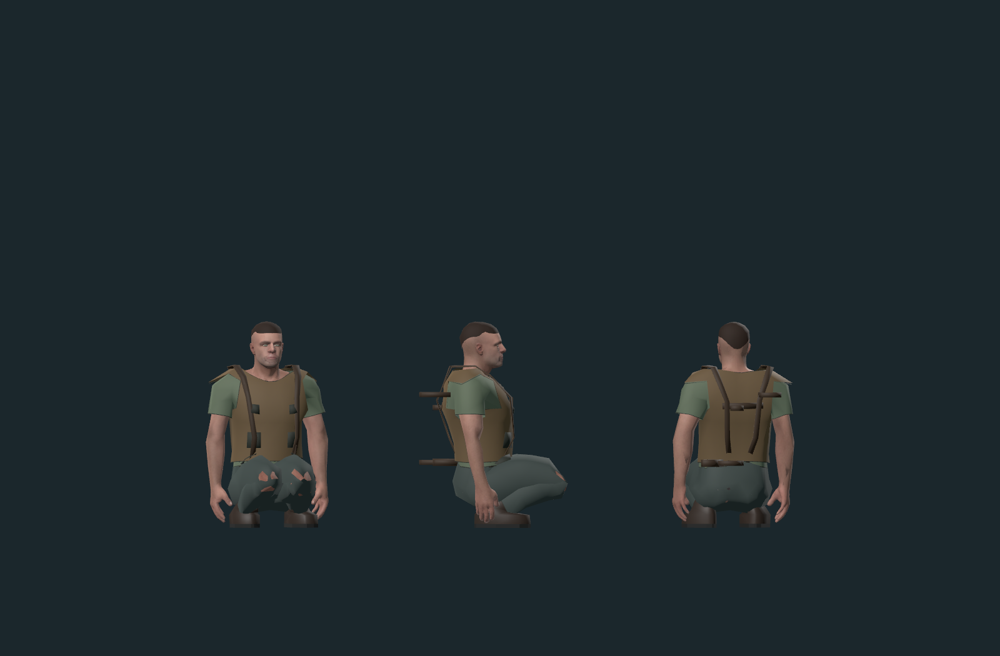

Base R11 outfit, same stage and mid-crouch pose. The skin patches at the knees
predate these garments. This pack does not replace the trousers or fix that defect.

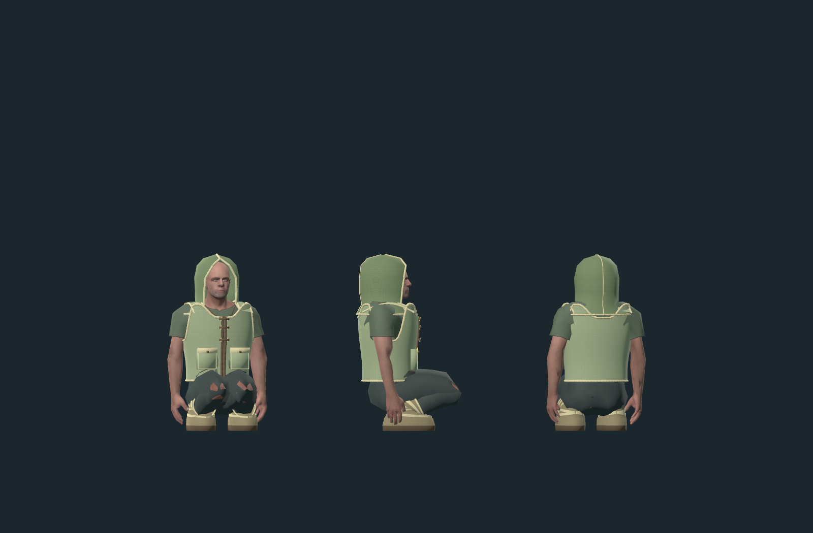

Same camera and pose. Hood, vest and footwraps remain attached; inherited knee
clipping remains visible. This image is not acceptance of the underlying trousers.

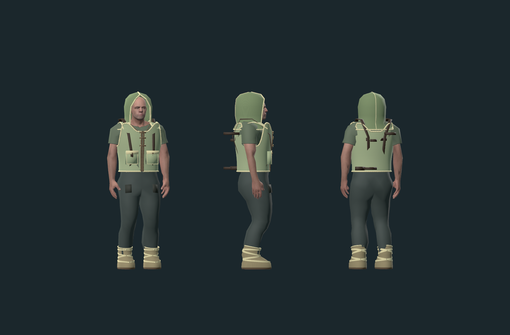

First fit: inherited carry straps protruded through the vest. Run samples also
exposed skin through the first sole. Replaced by scoped harness visibility and
larger closed soles. Earlier evidence is preserved, not represented as accepted.

## Changes and verification

- Independently authored geometry, weave textures and ten-bone weights. Original
  asset/data dedication CC0-1.0; generator/adapter/test code 0BSD. Exact paths,
  provenance and hashes: [pack](../../addons/characters/wearables/woven/README.md).
- One event-driven adapter for both views; cached meshes, no inventory polling,
  no runtime mesh authoring, no additional movement/animation owner. Remove
  restores original clothing, harness and hair visibility. Hood is hidden in FP.
- Real paid recipes and stable IDs 301–303, no inventory schema or gameplay bonus
  change. Actual garment icon tiles and compressed normalized ground models.
- 49 focused source assertions pass: geometry/weights, normalized ground meshes, paid recipes, wrong and
  stale drags, equip/remove, restoration of both storage components, FP/3P
  visibility, cached portrait rendering and six front/side/back pose samples.
- Existing inventory navigation regression: 24 assertions pass.
- Normal generated-world craft/equip/save: 15 assertions pass. Fresh process
  restoration: 8 assertions pass, including the production player-view binding.
- Offline credits freshness and item-icon dependency freshness are checked.
- Exact commands, source reports, hashes and retained failures: [evidence.json](evidence.json).

## Remaining / resume here

- Shown woven trader and trail appearances are approved. Broader animation
  review remains separate; see the sampled images and known inherited defects.
- Inherited trouser skin clipping remains. Return on a body/trouser fitting task;
  closure requires the same base-versus-new crouch comparison plus movement poses.
- Animation review is sampled, not all-frame or all-clip certification. Additional
  character proportions require a new fit and weight pass.
- Combined package now passes 49 clothing checks and 8 fresh-process checks in the
  existing owned world; the equipped portrait was visually inspected. Reports:
  `reports/woven_clothes/20261101T153115340716Z` and `20261101T153120603692Z`.
  New owned package-world paid crafting/equip/save and another process restoring
  both views pass 15 + 8 checks at `20261101T153321253890Z`.
  Installed PCK SHA256 `dec302a978bf81dd2bb27b53351f00740d7587aae4fb17b44bc46df349eee835`.
  Package drivers verify matching native libraries and never activate or capture
  the pointer. Full-world frame pacing and broader visual acceptance remain open.

## Reproduce / history

From TerraForest: `python tools/check_woven_clothes.py` for source/HUD renders;
`python tools/check_woven_clothes.py --world` for an exclusively owned, uniquely
named generated fixture followed by a second process. Neither targets user slots.
Append `--pack` to use the installed PCK. `--pack --restore-report <owned-report>`
reopens a prior `reports/woven_clothes/` fixture without creating another world.
Use `--trail` for the second set. For the resident trader, run
`python tools/check_trader_clothes.py --source-report reports/player_survival_world/20261101T144039859117Z`
(append `--pack` after a matching export). This clones the owned survival fixture.

Early source fixture rejected quantized weight sums with an overly strict float
comparison and produced unused black viewports. The check now uses the stored
weight precision bound and explicitly renders the review viewport. The first world
fixture failed the no-pointer-capture assertion because the browser reset the
offscreen flag; the fixture now reapplies that flag as the world scene is added,
matching the existing offscreen navigation harness. Those failed logs are retained.
