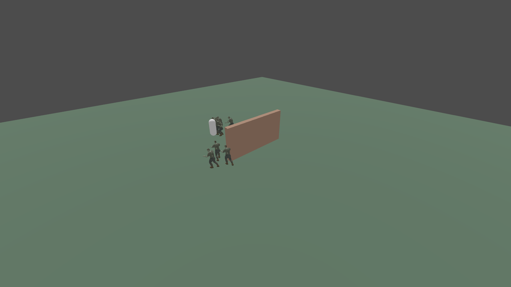
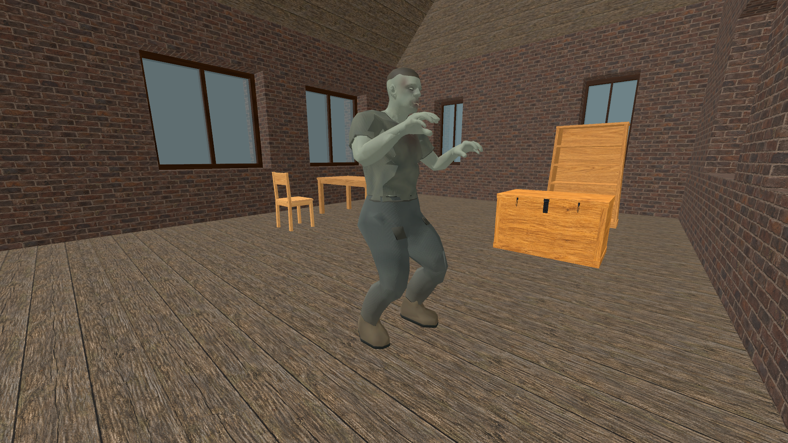
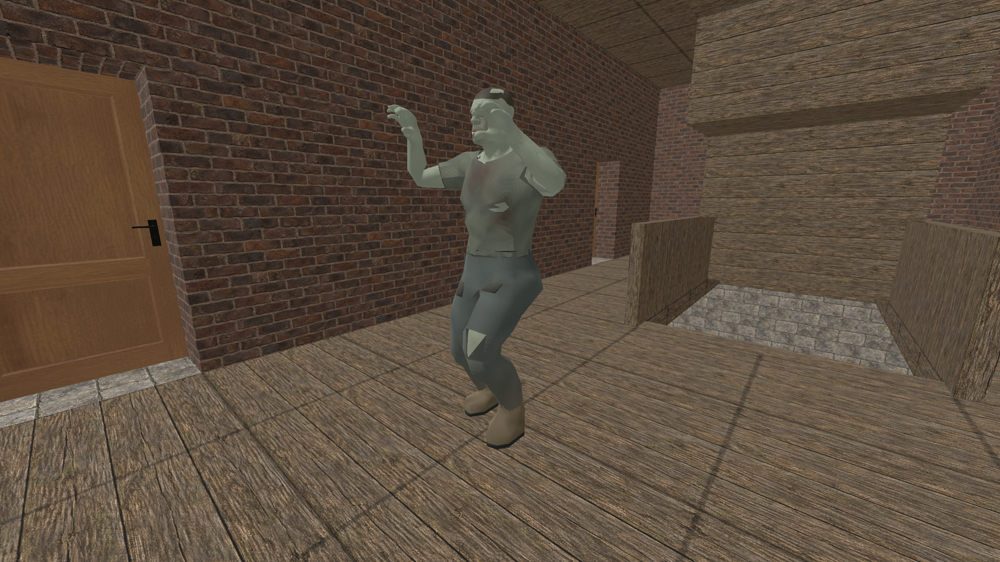
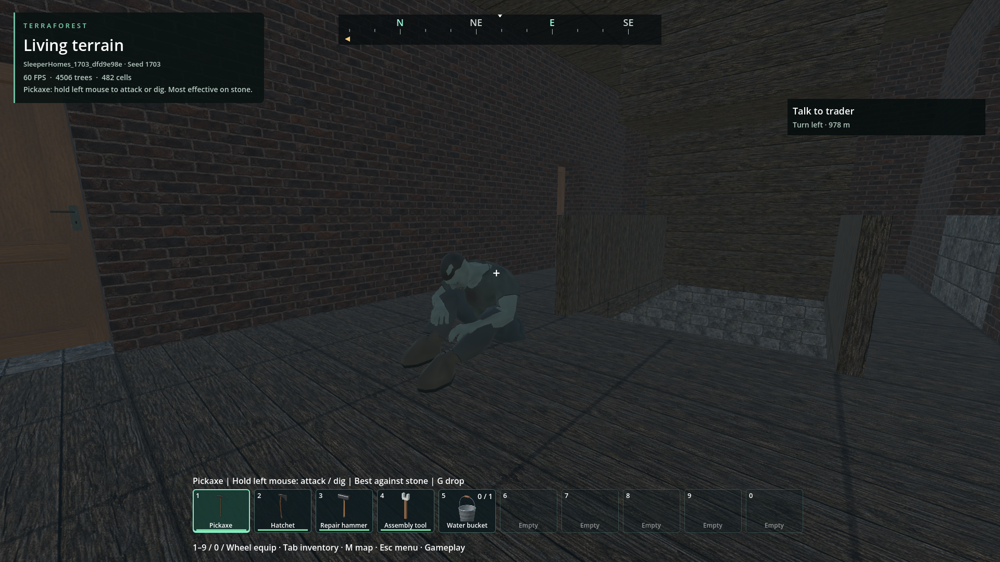
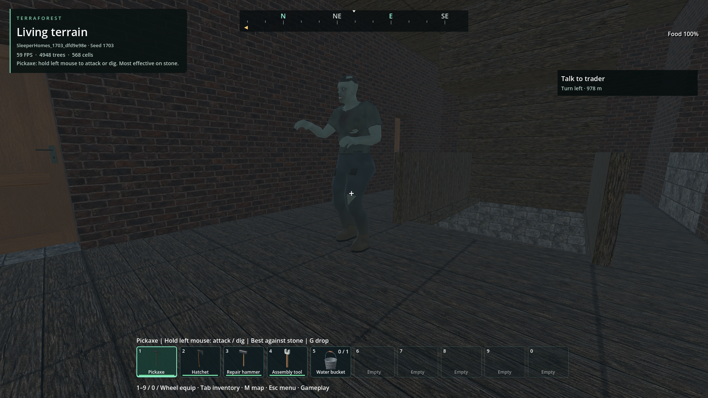

# Passive zombies and sleeper ambushes

- Status: Engagement/retaliation rework verified in scoped source and executable checks; user acceptance pending after repeated rejected playtests.
- Updated: 2026-11-05. Fix: sustained awareness, fair perception, moving-goal planning and encounter tuning.
- User review: Follow-up reports awake sleepers still mostly standing inside houses/mine. Earlier response/wake changes did not establish complete behavior acceptance.
- Symptom: Sleepers ignored a silent nearby player, rose slowly and failed to commit; ordinary zombies could disregard attacks or an obvious close threat.

## Stair support and pursuit follow-up — 2026-11-09

The previously failing furnished-tower search now passes its 18 assertions.
Midpoint-first probing merged adjacent legal 25 cm risers into a rejected 50 cm
step at exact grid alignments. Native support probes now run in travel order;
the actual collision regression fails three entrance cases before the correction
and passes all 12 checks afterward, including a genuinely impassable tall step.
No step, slope, capsule, readiness, water, scheduling or memory limit was widened.

The saved-world follow-up exposed replay of a connection rejected by live
capsule clearance. Bounded waypoint rejection now requests another complete
route, while a declared breakable door retains its approach and solid collision.
The 13-check actual tower round trip now passes, including attack contact and
return to the street; all 200 source save files retain their hashes.

Cold planning remains slow: 1,068 ticks / 17.8 seconds in the corrected debug
tower fixture and 35.2/45.0 seconds for outbound/return queries in the full host.
This fixes reachability/repeated blockage, not acceptable pursuit response time.
Moving-goal, physical stair/slope and release checks are tracked with the
[performance follow-up](../runtime-performance/foundation-2026-11-09.md).
Earlier failures below remain historical evidence; player acceptance and wider
world/multiplayer navigation remain open.

## Recalculation pauses — 2026-11-05 follow-up

User feedback: zombies take too long to recalculate and act. The focused baseline
reproduces losing movement when the moving target causes a replacement query,
and navigation becoming idle while a hit animation runs. The live response trace
also contains ordinary roaming/following actors and one pursuing actor; it does
not establish that every live stop is this defect.

The navigator now finishes only the next waypoint of its prior complete path,
within 2.5 m, while calculating the replacement from that fixed join. It waits at
the join if the full query is not ready; the new partial query supplies no motion.
Live motion checks still run on every step. Geometry/profile/exclusion/water
invalidation clears continuation, missing/failed paths stop it, and a physically
blocked retained point expires after one second. A replacement cannot send the
body back to a moving former start. Brief hit/action pauses retain active planning;
the animation/controller still decides when the physical body can move.

No planning work limit, 750 us cooperative deadline, capsule envelope, support
sampling, collision mask, interaction permission, memory or damage rule is relaxed.
The existing focused/crowd/room/commitment checks remain required, along with edit,
unavailable and physically blocked continuation cases in the new 14-check regression.
[Latency receipts, baseline and limitations](latency-evidence.json).

Cold complex initial routes and the separately failing tower fixture remain open;
this is a correction for interrupted recalculation and retaliation, not a universal
planning-time guarantee. Revisit long first-route reports with frontier/support and
body timing rather than raising timeouts or allowing unvalidated pursuit.

## Changes

### Engagement drive and tactical recovery — latest 2026-11-05 rework

The user rejected the route-only follow-up too, saying the zombies still lose
interest and do not care about a nearby player. That feedback supersedes earlier
scoped success claims. The live receipt confirms active awareness and planning
waits in the houses world; it does not establish a universal perception failure.
The behavior now separates engagement, route execution and combat reaction:

- A rejected search/recovery endpoint preserves the clue, provocation and alert
  state. Search retries are bounded instead of calling `rest()` immediately.
- A blocked route no longer starts an ignore-player cooldown. When an engaged
  body makes no progress for 1.5 seconds, or reports blockage for 0.5 seconds, it
  can choose a short tactical reposition on its current storey. The host releases
  that abandoned query once and validates the new destination with the same
  support, occupancy, readiness and native full-route guards. Reposition is an
  explicit action, not a direct-motion fallback or a claim of whole-world routing.
- Fresh sight updates the clue without cancelling the two-second recovery action
  at every probe. Melee proximity can interrupt recovery immediately. A three-
  second recovery cooldown bounds churn; reaching the waypoint resumes pursuit
  or investigation of the latest actual clue. Missing local collision still
  suspends the body.
- Investigation/search retain motivation until evidence expires. Finishing one
  search radius or failing a route cannot erase it. Finite unseen memory and
  actual loss of evidence still allow escape; ordinary/sleeper memory tuning is
  retained. Fresh audible evidence can break disinterest, with the same sound
  cooldown and hearing radius limits.
- Awake close awareness covers six metres in all directions, still requiring a
  ready, unobstructed sight ray. Sleeper directional caution remains unchanged.
- Ordinary hit stagger has a 1.8-second retrigger cooldown. Every accepted hit
  still damages anatomy and provokes; death, severing and firearm physical
  reactions retain their paths. Repeated light blows can no longer restart
  stagger and cancel every retaliation contact. Waiting engaged bodies also turn
  toward their intended destination while their native route is pending.

The commitment regression checks memory through rejected/blocked routes, evidence
renewal, finite escape, physical recovery toward an unreachable elevated target,
no attacks across the height gap, and retaliation during thirty real hits. Source
and executable both pass. Narrow-aisle/corridor, crowd perception, actual mine,
furnished-room, gait, sleeper safety and damage-region checks are retained in
[the current evidence](response-evidence.json). Existing assertions that required
blocked visible threats or one failed search to become uninteresting were updated
to the explicitly requested behavior; their original failures remain recorded.

Full navigation through arbitrary buildings, the synthetic tower-stair failure,
tight crawling passages and user balance acceptance remain open. The new actual-
hit receipt is still the return trigger if the standing/disinterest report recurs.

### Rejected route-only follow-up — 2026-11-05

The user again reports most residents standing and confirms that a hit produces
a reaction followed by more standing. The running process was checked: it used
this checkout and its current debug AI library, with the Last World route. This
was not established to be an old installation. The active save was
`SleeperHomes_1703_dfd9e98e`, not the owned mine used by earlier checks.

A stable, isolated clone replays actual saved residents without overwriting that
save. With menus/loading/focus/death gates clear, several provoked actors wait in
regional planning. A nearby upper-floor resident does pursue and attack even
before this correction. Thus the exact live report is not fully reproduced by
that close approach; the saved replay is diagnosis, not universal acceptance.

Two concrete navigation restrictions are corrected:

- Standing route/motion checks used a 0.35 m radius for a 0.24 m physical body.
  They now use the actual body radius, retaining conservative 1.8 m height and
  existing support, step, dry-footprint and swept-collision checks. A 60 cm aisle
  can be traversed directly instead of forcing a detour around its walls.
- Targets beyond 12 m or with >0.5 m height difference immediately used regional
  graph search. Regional queries now first validate a complete straight corridor
  in half-metre scheduler quanta. On a 26 m open slope this takes three updates
  and zero graph expansions (baseline 38 updates). Samples are unpublished until
  the complete path is valid; a wall falls back to the same graph search, and
  unavailable collision still stops movement. This is not direct movement on a
  failed/partial route. The 96 m query domain bounds this extra sample list to
  at most 273 positions; work/node/deadline budgets are unchanged.

The real cloned save also records an outdoor resident reaching attack contact;
random wandering differs between runs, so this is not a paired timing comparison.
Actors separated by buildings and the tower-stair failure remain outside that
success. [Current receipts, baseline and retained failures](response-evidence.json).

Normal gameplay now retains the latest six seconds after a hit in
`user://diagnostics/zombie_response.json`: availability gates, actual identities,
body/attack state, awareness and native routes. It holds at most seven samples,
performs no extra perception/route queries and never writes world data. Fixture
hosts do not enable it by default. If standing persists, inspect this actual-play
receipt before changing recognition/tuning again.

### Earlier sustained-pressure rework — 2026-11-05

Repeated playtest feedback rejected the earlier response changes. The new moving
player/obstacle fixture reproduced a deeper problem: all ten acquired pursuers
stood still. Updates to the moving goal discarded unfinished searches every
0.4 seconds. Allowing those searches to finish was necessary but insufficient:
ten independent local searches repeated expensive collision sampling. Obstacle
searches now enter the existing shared regional graph early. Open corridors
retain the local direct-path fast path; following actors keep useful validated
progress before refreshing a materially changed goal. Budgets and body collision
guards are unchanged. In the same twelve-second moving-goal fixture, movement
improved from **0/10 to 10/10**, with actual attacks reaching the target. This
fixture explicitly acquires the target to isolate navigation; it is not perception
evidence.

Ordinary recognition now takes 0.15–0.35 seconds, with 0.08-second recognition of
an obvious close threat. Visible sightings renew interest instead of triggering
an arbitrary visible-target timeout. Brief lost sight retains the last confirmed
clue for 0.75 seconds; investigation and search then keep an urgent gait. New
audible footsteps can refresh an investigation, with a bounded cooldown. A
confirmed acquisition supplies nearby residents a local sound clue, without
relaying a hidden player's location or creating a hearing-only alarm chain.

Perception remains limited to two probes per update, now in rotating overdue
order: **16/16 residents acquire the player at 20 Hz**. Previously early residents
could consume every probe at a low update rate. Quiet idle/wander pauses are
shorter, and failed full-radius room goals get two bounded shorter supported
candidates. Navigation still validates every accepted route.

Sleepers check ahead within 4.5 metres and all bearings only within 1.5 metres;
their posed-head ray must remain unobstructed through 0.25 seconds of caution.
This is directional caution, with no automatic spherical wake through walls.
Guarded rises run at 2× speed and still require physical completion. Sleeper
pursuit uses a 3× walk multiplier. Ordinary chase uses 2.2–2.6×; close/provoked
responses use 2.8–3×. Original animation data and gait continuity are preserved.
The unchanged save schema retains authored sleeper identity after waking.

Fly no longer suspends the entire host. Menus, death, focus, collision readiness
and other existing suspension gates still apply. Height/reach, attack contact,
blocked-route expiry and finite unseen/search memory remain enforced.

The actual owned mine fixture now moves the on-foot player through the station
with normal perception: **all ten sleepers move, six land attacks, player travel
5.15 m** in source. The rebuilt executable repeats this with ten moving, seven
attacking and 3.43 m of player travel. Furnished cottage and upper-floor house checks also move a physical
player capsule with normal perception. [Current evidence and retained failures](pressure-evidence.json)
separate these encounters from the isolated moving-route fixture.

Rendered route fixture after ten seconds, Forward+ 1920×1080. White capsule marks
the moving target; several pursuers have rounded the wall and reached it. Image
inspected for geometry and pose only; the trace proves movement and damage.
Earlier/rejected evidence remains below. Player difficulty/animation acceptance
is still pending.

### Historical floor-selection follow-up — 2026-11-04

The normal-host wander/search path reused the outdoor admission floor probe:
collision mask 1 (terrain), with a start four metres above the requested point.
In both actual furnished house prefabs, every one of 17 valid room destinations
was rejected even though collision was ready and the resident-floor probe found
support. Accepting an unsupported goal returns native awareness to idle. This
was missed by earlier wake-only interior checks and clear-floor pursuit fixtures.

Wander/search now use a separate selector with static support mask 7 and a
30 cm probe start above the expected floor. It recognizes building floors,
stays below ceilings and uses the standing/crawling slope policy. The complete
probe/body bounds, dry-floor and occupancy gates remain mandatory; native routes
still prove reachability before movement. Ordinary outdoor admission retains
its original terrain-only probe. All 17 room destinations now resolve to their
occupied storey; normal-host furnished-house pursuit/contact also passes.

The actual mine has a separate global gate in `demo/world.gd`: Fly mode passes
`pursue=false` to the entire zombie host. This freezes awareness/behavior even
after provocation. In the read-only mine fixture, all ten authored sleepers
advanced and all ten landed attacks on foot; enabling Fly froze their bodies and
intent, and disabling it restored attacks. That diagnostic established the old Fly policy, not the cause of every reported
mine stall. The 2026-11-05 rework above removes that global suspension.

[Follow-up evidence](interior-evidence.json): furnished-floor/pursuit checks,
normal full-world mine update and Fly transition, and the existing behavior
regression. The first mine diagnostic teleported to the surface because it did
not supply a fixed underground height; corrected before the mine acceptance run.
That setup run remains in `reports/checks/20261104T211844244808Z/` and is not mine
pursuit evidence.

Current rendered source fixtures, actual furnished prefabs, fixed nearby target,
Forward+ 1920×1080. Inspected current contact poses, not an AI before/after
comparison or broad navigation approval. Trace assertions establish actual
movement and damage. Provenance is appended to the existing image manifest.

### Historical response and waking work — superseded tuning

Sleepers check a stationary player within 2.5 m using a ray from their actual
posed head. About 0.4 seconds of uninterrupted, ready, unobstructed sight triggers
waking; breaking sight clears caution. Noise and damage retain existing wake
paths. Proximity alone cannot wake sleepers through walls.

The authored rise plays at 1.65 times its previous rate. Clearance sampling,
collision checks, retry budgets, anatomical restrictions and physical/native
completion handshake remain authoritative. The shipped minimum wake timer is
1.1 seconds; the full physical rise still gates combat. At 60 Hz the close-approach
fixture completes seated/lying waking in approximately 2.4/3.0 seconds including
caution. Waking actors track only a player they can actually see, then enter chase
immediately after rising.

Sleepers use at least a 2.2 chase multiplier over their own ordinary walk speed.
Last-sighting memory lasts 35% longer (capped at 30 seconds) and local search 50%
longer (capped at 15 seconds). Authored identity retains this temperament after an
awake save/reload; the save format is unchanged.

Ordinary distant recognition, roaming and unprovoked pursuit budgets are retained.
Inside the existing 2.5–3 m near-sense range, confirmed visible recognition takes
0.2 seconds and chase speed uses at least a 1.8 multiplier. All accepted damage
paths provoke awareness. Retaliation checks behind the zombie and bypasses
recognition once sight is confirmed. Visible close threats interrupt disinterest.
Close threats, provocation and ambushes renew interest while sight persists.
After losing sight they retain only the last clue; unseen/search/blocked expiry
still permits escape.

## Images

Current source build, seed 1703, generated house upper floor, 1920×1080 Forward+.
Player held outside close sensing range for the sleep pose capture.

Same house, camera and settings after a test noise wakes the resident. Both images
were inspected. These establish supported poses in actual building geometry;
timing, targeting and damage come from regression traces. They are current
evidence, not a before/after AI comparison or player approval of animation feel.
[Image sources and hashes](images/manifest.json).

## Verification

[Compact evidence record](evidence.json), with links to retained local reports:

- Debug/release native builds, awareness and shipped-profile checks.
- Rendered aggression fixture: close/walled/unready sensing, interrupted caution,
  both rises, immediate targeting, physical attack damage, retaliation, memory
  expiry, cooldown and the existing two-probe perception budget.
- Existing sleeper runtime and fresh-process restoration: ceilings, bounded
  retries, supported reversal on leg loss, pause, death and completion handshake.
- Generated house creation, wake, awake reload, death persistence and hidden
  re-admission; actor-route and zombie navigation regressions.

Original code/tests were authored with OpenAI Codex from the maintainer's request
under 0BSD; tuning uses the existing original CC0 data. No external code,
animation or asset was imported for this fix.

The first new harness run lacked scene attachment because a one-line callback
captured the following statement; corrected before passing checks. Retained log:
`reports/checks/20261104T141527888746Z/`. The first generated-house admission
phase did not find its selected resident; the fresh-process retry passed with
that same selected identity. A proposed fallback to another resident was not
exercised and was removed. The initial failure's cause remains unqualified;
production admission and fixture selection are unchanged. Original failed phase:
`reports/house_sleepers/20261104T141821378613Z/admission/`.

## Remaining / resume here

Player balance review remains open after the repeated rejection of earlier tuning.
Return on outdoor, house or mine playtest feedback; retain actor identity,
perception/availability, awareness goal/state, native route and motion rejection
if a resident again stands without responding during active play. Replay that
position in the moving-player fixture before claiming a universal fix.

Long tower-stair planning, arbitrary doorway/chokepoint crowds, distant streaming
and all-world performance are not established by these ten/sixteen-body checks.
The broader regional-navigation regression's tower case and baseline comparison
are recorded in the current evidence; retain the failure independently of the
passing local stairs/mine cases. Resume it with route frontier and supported
storey traces. Close with an actual multi-flight journey and bounded planning,
not a larger timeout or direct movement around a failed route.

The transient house-admission failure should be revisited if it reproduces;
retain selected/admitted identities and loading/publication timing on the next
failure before attributing it to capacity or streaming.

The initial export found unsupported compressed WAV containers in the existing,
unintegrated `addons/audio_runtime/packs/Kaino/` source folder. This AI build
temporarily excluded that unused folder during export; originals remain intact.
Audio import/integration belongs to a separate task. No audio conversion or
playback behavior change is included here. Original export failure retained in
`reports/zombie_ai_import.log`; the final export log records success.

## Reproduce

`python tools/check_zombie_aggression.py` runs the source fixture; add
`--executable` after exporting matching DLLs/PCK. Use
`python tools/check_zombie_sleepers.py runtime` for physical safety/restoration.
The aggression fixture owns an isolated scene. The house checker creates a
`SleeperHomes_` save; user saves are left intact.
