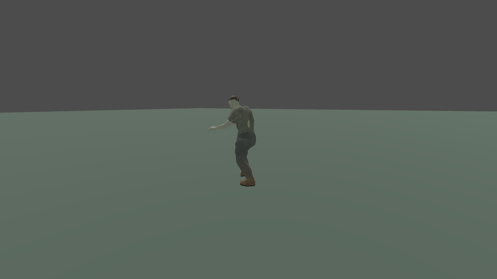
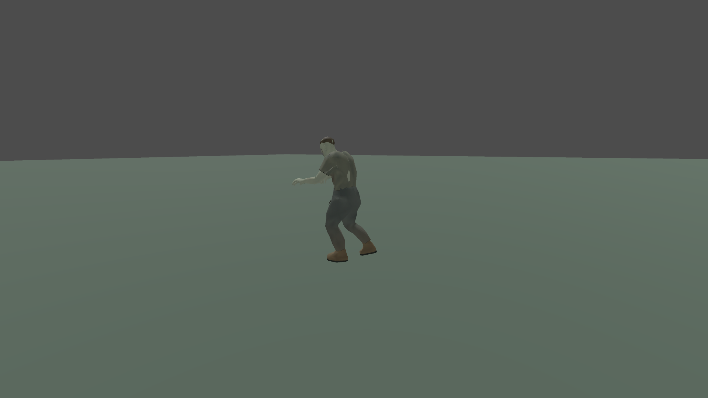

# Zombie walking resets

- Status: Fixed for reproduced playback cases / player review pending.
- Updated: 2026-11-04. Source: `addons/characters/runtime/zombie.gd`.
- Symptom: Fast walking appeared to restart instead of cycling continuously.

## Cause and changes

Both authored walk clips already join their first/last poses within 0.000001
transform error. Reapplying the same playing clip also retains its cursor.
The reproduced resets came from changing between relaxed and alert walking,
which started the new clip at zero, and short native waypoint handoffs switching
to idle before restarting walking. The baseline fixture recorded both phase
resets and two walk→idle interruptions during eight seconds of real pursuit.

Relaxed/alert changes now preserve the normalized gait phase. Their hips and
legs are identical, so supporting feet stay at the same position while the upper
body blends to the new intent. A missing/consumed waypoint holds the walking pose
for up to 0.25 seconds with zero requested horizontal movement. Longer stops
settle into idle. Native motion guards, body integration and route ownership
remain unchanged; a held pose never permits movement through an unavailable route.
Explicit restart, injury/attack transitions and ordinary idle behavior retain
their existing semantics. No animation asset or AI difficulty tuning changed.

Original fix and regression code were authored with OpenAI Codex from the user's
reported issue under 0BSD. Existing character/animation provenance is preserved.

## Verification and images

[Evidence record](evidence.json) links exact reports, hashes and retained failures.
Final rendered checks pass 15/15 in source and 15/15 in the actual executable;
the existing gait regression passes 24/24 and aggression regression 43/43.
The continuity fixture checks both asset seams, same-clip playback, bidirectional
intent changes, supporting feet, short/long route stops, explicit restart and
real native pursuit at 1.98 m/s. Existing gait checks cover planted skin, actual
body travel, collision stopping/resumption, suspension, attacks and leg loss.
The aggression fixture checks the previous sleeper/retaliation changes together
with this controller fix.

Source continuity fixture, 1920×1080 Forward+, isolated flat floor and actual
native moving-target pursuit. Current frames 120 and 126, following camera;
these are different gait phases, not a before/after comparison. Images were
inspected for supported posed movement. Trace/cursor checks establish continuity;
stills alone cannot establish animation smoothness. [Image provenance](images/manifest.json).

The first rendered assertion also counted the intentionally long initial route
planning pause. It was narrowed to short waypoint handoffs, while separate
assertions require long stops to enter idle. The failed rendered run is retained
alongside the original three-failure baseline; neither is relabeled as passing.

## Remaining / resume here

Player review of fast pursuit in the reported world is still required. If a
restart remains visible, capture the clip, cursor, awareness state and native
route state around it; distinguish actual attacks/hits, long stops and authored
gait aesthetics from a mid-stride reset. This fix does not qualify terrain foot
IK, dense mine crowding or broader animation art acceptance.

Run `python tools/check_zombie_gait.py`; add `--executable` for the exported build.
The fixture owns an isolated scene and leaves player saves and pointer capture
alone. The existing unused Kaino audio folder was temporarily excluded during
export as in the preceding AI build; unsupported raw WAVs remain intact.
