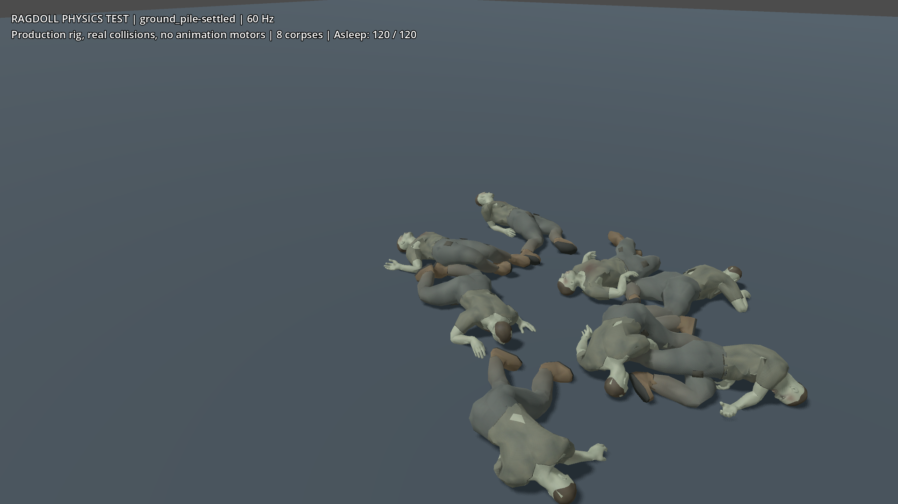
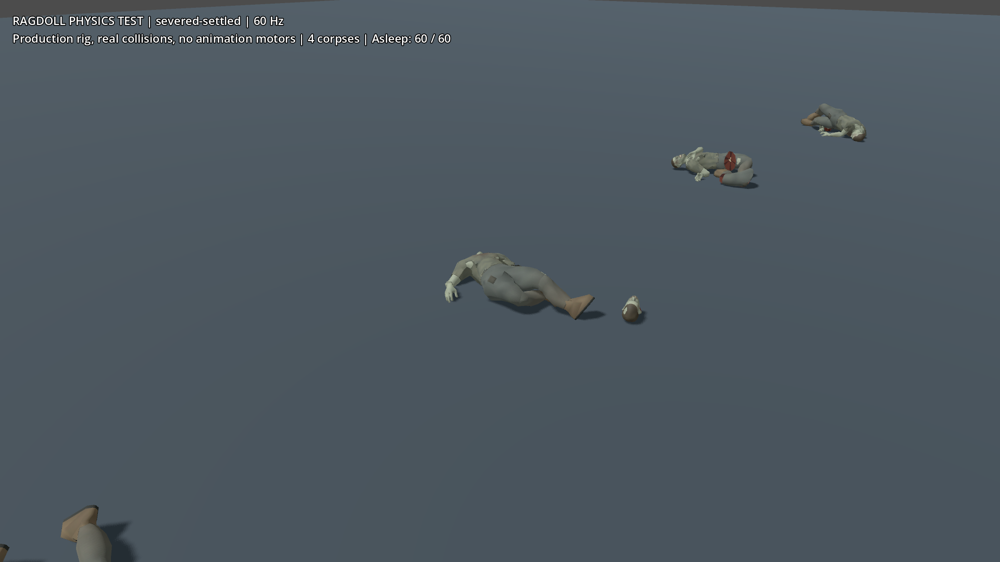
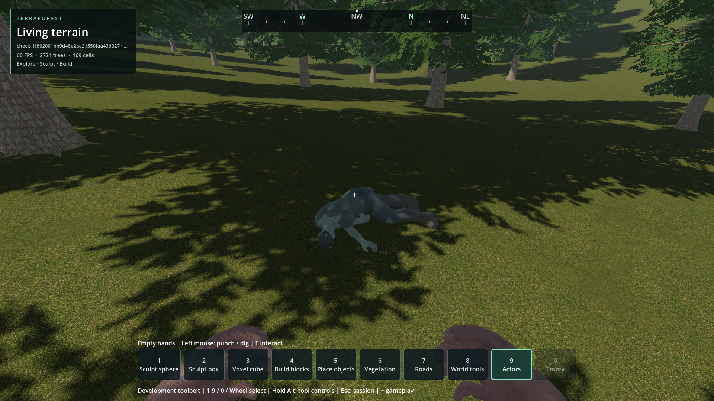

# Zombie ragdoll stability

- Status: Default-60-Hz vibration and walk-over corrected in scoped checks; player review pending.
- Updated: 2026-10-28. Installed package and matching debug/release libraries.
- User review: New changes and captures not yet reviewed.
- Symptom: Corpses can chatter, stretch at joints, or remain suspended after support changes.

## Current correction — 2026-10-28

- Built-in Jolt now uses 16 velocity / 8 position steps at the unchanged 60 Hz
  physics tick. Unsupported joint softness/ERP and shape-bias overrides are skipped.
- Removed repeated per-limb velocity/gravity suppression. Normal solver integration
  keeps the rig coherent under player load. Engine sleepers qualify for group
  rest; actual impacts and freshly verified support loss restore active dynamics.
  Expired contact owners are ignored; gentle player top loads are not new hits.
- Players can step over verified-resting corpses with at most 55 cm swept lift.
  Ordinary stairs remain 30 cm. Head/forward/landing sweeps and collision remain;
  active ragdolls are rejected. No moving-platform limbs, deleted joints, animation
  motors, self-collision exemptions or changes to health/dismemberment balance.

All ten packaged fixtures pass settle, impulse and 12 cm support-withdrawal phases.
Maximum separation includes every phase; the strict limit remains 80 mm.

| Fixture | Maximum separation | Initially settled |
| --- | ---: | ---: |
| Flat | 34.2 mm | 60/60 |
| Slope | 35.0 mm | 60/60 |
| Stairs | 35.2 mm | 60/60 |
| Rubble | 43.0 mm | 60/60 |
| Wall/corner | 45.2 mm | 60/60 |
| Ledge | 36.5 mm | 60/60 |
| Drop pile | 73.6 mm | 120/120 |
| Severed chains | 34.7 mm | 60/60 |
| Far origin | 56.2 mm | 60/60 |
| Ground pile | 31.2 mm | 120/120 |

[Matrix](evidence/queued-pack-stress.json), [build/command](evidence/queued-pack-stress-run.json).
Packaged support passes 31 checks; physical hit/severing regions pass 39; anatomy,
awareness, geometry reuse, behavior and step/slope contracts pass. Four-direction
actual-capsule walking reaches every destination without jumping, keeps joints
below 80 mm and returns all 15 bodies to rest after each crossing.
[Walk](evidence/queued-walk.json), [support](evidence/queued-support-run.json),
[regions](evidence/queued-regions-run.json).

Rendered ground-pile/stairs/severed fixtures pass with every body asleep.
Actual streamed forest contact, landing, loot-pause/resume, explicit wakes and
external impulses pass all 15 phases; 14 joints remain and 15 bodies sleep afterward.
[Rendered matrix](evidence/queued-graphical-stress.json), [forest](evidence/queued-forest.json).
Player movement/stance, doors, vehicle exit and real driving/suspension/parked-car
collision checks pass. Vehicle package evidence:
`reports/checks/20261028T082918413737Z_queued_pack/vehicle_physics_compatibility/`.


Installed Jolt package, 60 Hz, eight intact corpses: 120/120 asleep. Isolated
fixture without a world seed; not matching poses with the older comparison.


Four intentionally severed death poses: 60/60 asleep. Detached pieces are not
joint explosions. Separate fixture, no world seed.


Seed 1703 temporary streamed forest after all 15 phases; 15 bodies asleep.
Tree shadows darken the corpse. Different view/pose from older captures.
All three images inspected; motion is established by traces, not still pictures.
[Sources/hashes](images/2026-10-28.json). Player acceptance remains separate.

### Remaining / resume here

- Alternative **30 Hz physics** still fails four strict gates in pile/far-origin/
  ground-pile tests. This is not render FPS or the shipped 60 Hz tick.
  [Retained result](evidence/queued-30hz-unqualified.json), [run](evidence/queued-30hz-run.json).
  Do not offer lower physics rates without passing the same limits.
- Endurance, moving vehicle/door impacts, larger piles, lower-end CPU cost and
  player feel remain unqualified. Return with reproducible full contact/support/
  rendered evidence; no user save was changed.
- One region rerun expected the removed custom integrator despite six sleeping
  fragments. The corrected assertion requires normal integration and retains
  CCD/support-loss gates. [Original](evidence/queued-regions-old-integrator-assertion.json).
- One forest harness missed the immediate impulse sample: it saw 0.0988 m/s after
  damping and falsely rejected a moving corpse. Measuring authoritative state
  before the first wait records 0.320 m/s. Speed, displacement and articulation
  limits are unchanged. [Original](evidence/queued-forest-missed-first-sample.json),
  [corrected run](evidence/queued-forest-run.json).
- Earlier per-limb-freeze walking trials stretched joints and were rejected;
  their local logs remain. Current forest checks cover loot suspension, not a new
  fresh-process corpse-persistence qualification; historical persistence below
  predates this solver change. Captures used offscreen non-activating windows
  without requesting cursor capture.

Reproduce: `python tools/check_zombie_ragdolls.py --pack` includes corpse walking.
The results below retain the previous solver's failures; the new default matrix
supersedes them and their old task list, not arbitrary hardware/timestep behavior.

## Historical changes and verification — 2026-10-26

- A reproduced 12 cm support withdrawal left rotated resting parts floating. The
  old half-metre centre ray incorrectly accepted the lower floor as support.
  Cached real contact anchors now use a 5 cm verification segment. Wall contacts
  cannot qualify as ground; resting contact separation is checked too.
- Native contact islands now span different zombie anatomy owners, not just a
  corpse and its own detached limbs. Work runs once per physics frame, with a
  10 Hz support/settling graph, hashed body ownership and expired-body cleanup.
  Disabled/frozen subtrees are excluded. Joints remain connected throughout rest.
- Grounded passive damping is stronger; original airborne damping, gravity
  integration and CCD return when support disappears. No velocity cap, automatic
  death timeout, deleted joints, extra animation motor or collision exemption.
- Shared health, limb health, dismemberment balance, live AI and save schemas are
  unchanged. Test worlds are disposable; player saves are not modified.
- The new regression checks small support edits, rotated shapes, a three-owner
  stack, restored airborne settings and gravity. The stress matrix covers four
  death poses on flat ground, slope, stairs, rubble, a wall, a ledge, eight-corpse
  ground/drop piles, severed chains and far-origin coordinates. It retains strict 8 cm
  anchor, 120 rad/s angular and 2.5 m anatomy-radius gates.

## 60 Hz packaged headless stress results

Peak initial-settle joint separation; sleep count at the end of the settle window.
Each case also checks impulses and a 12 cm support withdrawal. Four corpses per
case, eight in the drop pile; all three phases must pass for a case to pass.

| Fixture | Peak anchor error | Settled bodies | Result |
| --- | ---: | ---: | --- |
| Flat | 66.6 mm | 60/60 | Pass |
| 20-degree slope | 53.4 mm | 60/60 | Pass |
| Stairs | 60.5 mm | 60/60 | Pass |
| Rubble | 70.1 mm | 60/60 | Pass |
| Wall/corner | 73.1 mm | 60/60 | Pass |
| Ledge fall | 86.7 mm | 60/60 | Fails initial 80 mm gate |
| Drop pile | 452.5 mm | 0/120 | Fails impact and rest; peak 261.3 rad/s |
| Severed chains | 58.3 mm | 60/60 | Pass |
| Far origin (1550,45,1550) | 80.4 mm | 45/60 | Fails initial/wake/support-edit gates |
| Ground-level pile | 70.7 mm | 15/120 | Bounded but fails rest deadline |

[Raw final matrix](evidence/pack-stress-final.json),
[exact command/hashes](evidence/pack-stress-run.json),
[failed assertions](evidence/pack-stress.log).
The earlier nine-case matrix at original damping failed 14 gates; the same nine
cases with final tuning fail 7. Adding the ground-level pile gives 8 failed gates.
That is improvement, **not** closure. In particular, do not round the far-origin
80.4 mm result down to a pass. Rejected trials and earlier results stay archived.

Passing ordinary interaction tests does **not** close the failing stress cases.
Instrumented physics timings include observer/spawn cost, not an uninstrumented
gameplay benchmark; another development task briefly ran graphical tests too.

Native debug/release compilation, 50 release health/anatomy checks and 31 release
awareness checks pass. Source regression suites pass anatomy, awareness, geometry
reuse (30), behavior (18), physical hit/severing regions (39), capsule step/slope
contracts and all 15 corpse reactivation phases. Final packaged equivalents pass;
the first package runner's anatomy/awareness **report-directory errors** were
retained and fixed by writing external-driver reports outside the read-only PCK.

The final support regression passes 31 checks, including airborne damping/CCD
restoration, native rest across three anatomy owners and expired-group cleanup.
Early stack assertions mistakenly read a stale `RigidBody3D.sleeping` scene
property after native-server sleep. The corrected test reads authoritative native
statistics; those earlier assertions are harness failures, not proof of suspension.
The contact-anchor-cache trial did not cure dense-pile chatter and was reverted.

Targeted flat/severed runs fail four gates at 30 Hz and pass at 120 Hz. These are
alternative **physics tick rates**, not render FPS measurements. The game remains
at its normal 60 Hz; do not lower that setting as a performance workaround.

Graphical forest interaction passes all 15 phases. Fresh-process packaged corpse
save/reopen passes 18 build / 9 reopen checks, including visible target selection,
rest and physical reactivation. It uses its own `gather_lifecycle_*` slot.
Graphical stairs/severed fixtures remain bounded but each leaves one corpse awake
at the eight-second settle deadline: those two failures remain open, despite the
headless passes. Captures are not evidence of zero motion or player approval.

The final graphical flat case passes, with 60/60 bodies asleep. The ground pile
fails rest (0/120 asleep) and its impulse-phase anchor gate. Actual held-tool combat,
shared/limb health, severing and world corpse restoration pass all 43 world checks.
The initial world-test launch omitted gameplay mode, leaving encounters disabled;
the runner now requests that required mode explicitly rather than bypassing spawn
admission. Its earlier failed launch remains in the local run history.

Hardware: i5-12450H (8 cores / 12 threads), RTX 4050 Laptop GPU, Windows 10,
Godot 4.7.2, 1080p graphical captures. Native/runtime identity is in the archived
run manifests; no new global solver iterations or GPU passes are introduced.

## Images


Final packaged 60 Hz, isolated flat fixture: all 60 bodies asleep. No world seed.


Final packaged 60 Hz ground pile: 0/120 asleep. This remains a failed case.


Seed 1703, owned test slot, final packaged read-only reopen; intact visible corpse.


Earlier verified packaged link, temporary seed 1703 forest after all 15 interaction
phases. Different view/pose from the reopen; not a matching before/after pair.


Earlier 60 Hz graphical stairs: bounded but 45/60 asleep at eight seconds.


Earlier 60 Hz severed chains: 45/60 asleep at eight seconds. White diagnostic
materials/camera differ from final gray fixtures. These failures are not erased.

Sources, hashes and build identity: [image manifest](images/manifest.json).
All images were inspected; user visual/motion approval is still required.

## Historical remaining work — superseded by current default results

- Diagnose initial-impact joint stretch and persistent contact chatter in the
  retained failing cases. The drop pile falls into a small area from up to 12.6 m;
  this is deliberately more severe than an ordinary ground-level death group.
  Return with reproducible frame/bone traces and compare solver/body geometry,
  not wider assertion tolerances or blanket collision suppression.
- Simple mass/angular/joint substitutions worsened other cases, so a constraint/
  geometry investigation is needed rather than shipping those trials. Retained
  failing fixtures and their existing gates are the prerequisite for that work.
- Require the full stress matrix, existing contact/loot/restoration regressions,
  and reviewed rendered motion before claiming broad ragdoll stability.
- Long-session piles, moving vehicles/doors against corpses, extreme speeds,
  lower-end hardware and aesthetic/player acceptance remain unqualified.
- [Earlier contact/save repair](../../docs/evidence/zombie_corpse_contact/README.md)
  retains its original failures, captures and narrower passing evidence.

## Reproduce / history

Run from the project folder:

```powershell
python tools/check_zombie_ragdolls.py
python tools/check_zombie_ragdolls.py --checks zombie_ragdoll_stress --stress-case pile
python tools/check_zombie_ragdolls.py --checks zombie_ragdoll_stress --stress-hz 30
python tools/check_zombie_ragdolls.py --pack --graphical --checks zombie_ragdoll_stress --stress-case stairs --stress-case severed
```

The complete campaign intentionally exits nonzero while any stress gate fails.
Pack checks require a fresh export with matching external native DLLs. The runner
retains commands, script/native/engine/PCK hashes, logs and every failed check.
Report folders are local and ignored; selected evidence is archived here.

Rejected trials: doubling terminal masses, reducing angular recovery to 0.05,
cone wrists/ankles, hinge substitutions and contact-anchor caching did not pass. Some substantially
worsened high-impact behavior; none is shipped. Their failed results are retained.

Code: [native anatomy](../../addons/world_runtime/native/zombie_anatomy.cpp),
[support regression](../../tests/zombie_rest_support.gd),
[stress matrix](../../tests/zombie_ragdoll_stress.gd),
[campaign runner](../../tools/check_zombie_ragdolls.py).
